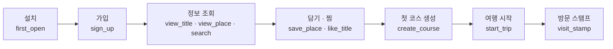

# 앱 분석 이벤트 (MZ2AZ-353)

- **상태**: iOS·Android 둘 다 SDK·이벤트 기록·설정 값까지 들어가 **분석이 켜져 있다**(2026-10-05)
- **담당**: 정승길(앱) · Firebase 프로젝트는 정권호·정승길
- **근거**: 2026-10-01 윤지환 멘토님 마케팅 멘토링(볼트 `00_멘토링 및 회의역사/71_(10.01) 윤지환 멘토님 마케팅`), 2026-10-03 팀 회의

## 1. 왜

광고를 집행하기 전에 **들어온 사람이 무엇을 하고 다시 오는가**를 알아야 한다. 멘토링의 결론이 「설치·가입이 아니라 첫 가치 행동을 재라」였고, 우리의 첫 가치 행동은 **씬 담기·찜 → 첫 코스 생성**이다. 10월 계획이 「측정 모델 적용 · 베타 테스트 · 오가닉 데이터」다.

도구는 무료인 것만 쓴다 — **Firebase Analytics(= GA4)** 와 UTM. MMP(유료)는 넣지 않는다.

## 2. 퍼널

- **핵심 지표(KPI)**: `create_course` — 광고 소재·채널을 비교하는 기준
- **리텐션**: `create_course` 뒤 30일 안에 `start_trip` 이 있는가(방한해서 앱을 쓰는가)
- 가입은 지금 필수가 아니다(비회원도 담고 코스를 만든다). 그래서 퍼널에서 `sign_up` 을 건너뛰는 사람이 있다 — 사용자 속성 `account` 로 나눠 본다

## 3. 이벤트

이름은 GA4 규칙(소문자·밑줄, 40자 이하). GA4 가 미리 정해 둔 이름이 있으면 그것을 쓴다(★). **두 앱이 같은 이름·같은 매개변수를 쓴다.**

| 이벤트 | 언제 | 매개변수 | 구현(iOS) | 구현(Android) |
| --- | --- | --- | --- | --- |
| `first_open` ★ | 설치 뒤 첫 실행 | (SDK 가 자동으로) | — | — |
| `select_language` | 언어를 골랐다(마이페이지 — 첫 실행 언어 고르기는 웹 MZ2AZ-523·iOS MZ2AZ-526 에서 없앴다) | `language` | `AppLanguage.choose` | `AppLanguage.choose` |
| `tutorial_begin` ★ | 사용법 첫 장이 보였다 | — | 보내지 않음(MZ2AZ-526 — 첫 실행 사용법 제거, 다시 보기에서도 안 보냄. 정의만 남김) | `OnboardingView` |
| `tutorial_complete` ★ | 사용법을 끝냈다(건너뛰기 포함) | — | 보내지 않음(MZ2AZ-526, 위와 같음) | `OnboardingView.finish` |
| `sign_up` ★ | 이 구글 계정으로 처음 로그인(가입) | `method` = `google` | `AuthStore.signInWithGoogle` | 미연결 — `AuthStore`가 main 에 없다(MZ2AZ-336 병합 대기) |
| `login` ★ | 다시 로그인 | `method` | 〃 | 〃 |
| `logout` | 로그아웃 | — | `AuthStore.signOut` | 〃 |
| `delete_account` | 탈퇴 | — | `AuthStore.deleteAccount` | 〃 |
| `set_nickname` | 닉네임을 정했다·건너뛰었다(MZ2AZ-363) | `skipped`(1·0) — **닉네임 자체는 보내지 않는다** | `AuthStore.setNickname`·`skipNickname` | 아직 |
| `screen_view` ★ | 탭·덮개가 바뀌었다 | `screen_name` = `search`·`home`·`community`·`courses`·`profile` | `RootTabs` | `RootTabs` |
| `search` ★ | 검색어를 확정했다 | `term_length`, `kind`(`content`·`person`·`place`·`typed`) — **검색어 원문은 보내지 않는다** | `SearchTabView.commit` | `SceneData.search` + `SearchTabScreen.commit` |
| `view_title` | 작품 상세를 열었다 | `content_id` | `ContentDetailView` | `ContentDetailView` |
| `view_place` | 장소 상세를 열었다 | `place_id` | `PlaceDetailView`·`RoutePlaceCard`의 대표 촬영지·`RouteStopCard`의 촬영지 | `PlaceDetailView` |
| `view_poi` | 편의시설 정보 카드를 열었다(MZ2AZ-408) | `poi_id` | `RoutePlaceCard` — 실제 대표 대상이 POI일 때 | 미연결 |
| `view_reviews` | 리뷰 시트를 열었다(MZ2AZ-363) | `target_type`(`place`·`poi`) | `ReviewsSheet` | 아직 |
| `write_review` | 리뷰를 썼다·고쳤다(MZ2AZ-363) | `target_type`, `rating`, `photo_count`, `has_body`(1·0), `edited`(1·0) — **글과 닉네임은 보내지 않는다** | `ReviewComposeView` | 아직 |
| `delete_review` | 리뷰를 지웠다 | `target_type` | `ReviewComposeView` | 아직 |
| `view_photos` | 사진첩을 크게 열었다(MZ2AZ-363) | `target_type`(`place`·`poi`), `entry`(`detail` 대표 사진 자리 · `reviews` 리뷰 시트 · `card` 지도 카드) — **사진 주소는 보내지 않는다** | `GalleryViewer` | `GalleryViewer`(리뷰 행 사진은 제외) |
| `like_title` | 작품 하트를 눌렀다 | `content_id`, `liked`(1·0) | `LikeStore.toggle` | `LikeStore.toggle` |
| `save_place` | 장소를 담았다(서버가 받았을 때) | `place_id` | `CartStore.add` | `CartStore.add` |
| `generate_plan` | AI 일정 초안을 받았다(저장 전) | `day_count`, `title_count` | `RouteStore` | `RouteStore.guideDraft` |
| **`create_course`** | **코스를 새로 만들어 저장했다**(고쳐 저장은 세지 않는다) | `course_origin`(`ai`·`self`·`review`), `day_count`, `place_count` | `RouteStore.save` | `RouteStore.save` |
| `start_trip` | 한 장소로 안내를 시작했다 | `place_id` | `TripSession.start` | `TripSession.start` |
| `get_directions` | 길찾기를 불렀다 | — | `TripSession` | `TripSession.fetchLeg` |
| `visit_stamp` | 성지에 도착해 도장이 찍혔다 | `place_id` | `TripSession.arriveNow` | `TripSession.markArrived` / `checkArrival`(둘 다 도착 판정이라 각각 기록) |
| `ask_guide` | 가이드 챗봇에 물었다 | — | `RouteGuide` | `RouteGuideSession.ask` |
| `post_review` | 여행후기를 올렸다 | `photo_count`, `has_course`(1·0) | `CommunityStore.add` | `CommunityStore.add` |

- **자동 화면 기록은 끈다.** Firebase 는 화면이 바뀔 때 `screen_view` 를 제 손으로도 보낸다 — 알림창·시트가 뜰 때마다 이름 없는 것이 섞인다. 우리는 이름을 붙여 직접 보내므로 끈다(iOS `Info.plist` 의 `FirebaseAutomaticScreenReportingEnabled = false`, Android 는 매니페스트의 `google_analytics_automatic_screen_reporting_enabled = false`)
- **매개변수 이름에 `origin` 을 쓰지 않는다.** Firebase 가 모든 이벤트에 제 `origin`(app·auto)을 붙여 겹친다 — 그래서 `course_origin` 이다

### 사용자 속성

| 속성 | 값 | 쓰임 |
| --- | --- | --- |
| `app_language` | `ko`·`en` | 언어별로 퍼널을 나눠 본다 |
| `account` | `guest`·`member` | 비회원·회원을 나눠 본다 |

## 4. 보내지 않는 것 (개인정보)

- **위 Firebase 이벤트에는 이름·이메일·설치 식별자·좌표·글 본문·검색어 원문을 보내지 않는다.** 작품·장소·편의시설은 우리 DB 의 id 로만 적는다
- **광고 식별자(IDFA)** — iOS 는 `FirebaseAnalyticsCore`(광고 식별자 없는 제품)를 쓴다. 그래서 추적 동의 창(ATT)이 필요 없다. **광고를 집행해 전환을 매체에 돌려주려면 다시 정해야 한다** — 그때는 동의 창과 처리방침 변경이 따라온다
- 분석 수집 자체는 개인정보 처리방침에 적어야 한다(수집 항목: 앱 사용 기록, 기기·OS 정보, 대략적 지역 — Firebase 가 IP 로 추정). 볼트 `(9주차) 08_앱이 다루는 개인정보` 참고
- 단위 시험 `AppEventTests.testNoPersonalDataInParameters` 가 매개변수 이름을 지킨다

### PostHog·Sentry (iOS, MZ2AZ-527)

iOS 의 `AppAnalytics.log` 는 위 표의 이벤트를 Firebase 와 **PostHog 둘 다로**, 같은 이름·같은 매개변수로 보낸다
(웹과 같은 PostHog 프로젝트 701967). PostHog 의 자동 수집(앱 생명주기·화면·누름·화난 연타·요소 글자·푸시)·swizzling·화면 녹화·설문은 끄고 IDFA 를 쓰지 않는다.
SDK 가 스스로 만드는 이벤트는 없다 — 다만 SDK 기본 속성(기기·OS·앱 버전·세션 id 등)은 우리 이벤트에 붙는다.
오류 추적 Sentry 는 충돌·오류만 보낸다(개인정보 기본 전송·성능 추적·브레드크럼 끔). 둘 다 키가 없으면 불리지 않고,
이용 통계 스위치를 따른다 — 구현은 `apps/scenetrip-ios/src/Analytics/ProductAnalytics.swift`·`ErrorReporting.swift`,
계획은 [iOS 1.0.1 §3](ios-1.0.1.md). Android 는 아직 Firebase 만이다.

### 우리 서버의 인기도 기록 (iOS, MZ2AZ-408)

Firebase와 별개인 생성 `POST /events`로 실제 상세 열기와 확정한 검색을 보낸다.
조회는 대상 종류·DB ID만, 검색은 원문·같은 검색의 첫 성공 응답에 표시할 총수만 보낸다.
설치 ID·선택 언어·선택 로그인 토큰은 요청 헤더에 담는다. 서버는 검색어를 기기·회원과
연결하지 않고 조회·검색 기록을 90일 후 삭제한다(`popularity.md` §5·§7).
검색 원문은 Firebase·메타 이벤트나 앱 디스크의 재전송 큐에 저장하지 않는다.
실패는 자동 재시도·로그인 갱신·화면 알림 없이 버린다.
[전송·검색 시점 계획](ios-usage-events.md)을 따른다. Android의 이 전송은 별도 구현이다.

## 5. 설정 파일

Firebase 는 앱 번들 안의 설정 파일로 켜진다. Firebase 프로젝트는 `scenetrip-5bf07`(2026-10-05, 정승길 생성).

| 플랫폼 | 파일 | 두는 곳 | 상태 |
| --- | --- | --- | --- |
| iOS | `GoogleService-Info.plist` | `apps/scenetrip-ios/resources/` | 번들에 실린다 — 분석이 켜져 있다 |
| Android | `google_services.json`(원본) + `res/values/firebase.xml`(파생 리소스) | `apps/scenetrip-android/src/main/res/raw/`, `.../res/values/` | 리소스가 실린다. `google-services` Gradle 플러그인이 보통 자동으로 만드는 리소스를 `firebase.xml`에 손으로 옮겨 적었다(Bazel 에 그 플러그인이 없다). 이 리소스가 있으면 Firebase 의 `FirebaseInitProvider`가 앱이 뜰 때 혼자 초기화한다 — `AppAnalytics.start`는 **직접 초기화하지 않고** 성공했는지만 확인한다(§8) |

- **두 파일은 저장소에 있다**(2026-10-05 정승길 결정). CI 와 팀원 빌드, 베타 빌드에 분석이 똑같이 들어가게 하려는 것이다
- 파일 안의 API 키는 **비밀이 아니다** — 앱에 그대로 실려 배포되는 식별자다. 다만 구글 클라우드 콘솔에서 이 키에 앱 제한(iOS 번들 ID · Android 패키지와 서명)을 걸어 두어야 남이 가져다 쓰지 못한다 — **아직 걸지 않았다**
- 파일이 없어도 빌드되고 돈다 — 없으면 `AppAnalytics.start` 가 Firebase 를 켜지 않고 이벤트를 버린다
- 구글 로그인은 이 프로젝트와 무관하다(다른 구글 클라우드 프로젝트의 클라이언트 ID 를 `Info.plist` 에서 읽는다)
- 프로젝트를 바꾸려면 콘솔에서 새 파일을 받아 같은 자리에 덮어쓴다

## 6. 확인하는 법

1. `just ios-run`
2. 시뮬레이터 실행 인자에 `-FIRDebugEnabled` 를 주면 Firebase 콘솔 **DebugView** 에 이벤트가 몇 초 안에 찍힌다
3. 퍼널 순서대로 눌러 본다: 검색 → 작품·장소 열기 → 하트·담기 → 코스 만들기 → 코스 시작

### 실기 확인 (2026-10-05, iOS)

DebugView 수신과 기기 로그(「Logging event」, 업로드 204)로 확인한 것: `first_open` · `screen_view` · `search` · `view_title` · `like_title` · `view_place` · `save_place` · `ask_guide` · `create_course` · `post_review`, 사용자 속성 둘. **아직 실제 전송을 못 본 것**: `start_trip` · `get_directions` · `visit_stamp`(길찾기가 유료 외부 API 를 불러 누르지 않았다) · `generate_plan` · `sign_up`/`login`/`logout`/`delete_account` · `select_language` · `tutorial_*`.

기기 로그로 보려면 `log show` 가 아니라 `log stream --level debug`(디버그 줄은 저장되지 않는다), 프로세스 이름은 `bin`.

## 7. 남은 것

- `sign_up`·`login`·`logout`·`delete_account`는 Android 쪽 `AuthStore`가 아직 main 에 없어(MZ2AZ-336 병합 대기) 연결하지 못했다. `select_language`는 MZ2AZ-343 이 main 에 들어오며 연결했다
- UTM — 스토어 등록과 랜딩 링크가 정해진 뒤(설치 출처는 Android 는 Play Install Referrer, iOS 는 App Store 캠페인 링크)
- GA4 에서 `create_course` 를 주요 이벤트(전환)로 표시, 퍼널·코호트 보고서 만들기(대시보드)
- 광고 집행을 정하면: 광고 식별자·동의 창, 구글 광고 연결

## 8. Android 구현 메모 (2026-10-05)

- `com.google.firebase:firebase-analytics:23.2.0`을 `MODULE.bazel`에 추가했다(BoM 대신
  버전을 바로 박는다 — 이 파일의 다른 Maven 좌표와 같은 방식). KTX 모듈은 2025-07 부터
  더 안 나와 일반 아티팩트를 썼다
- **`FirebaseOptions`를 코드로만 지어서는 분석이 안 켜졌다.** `FirebaseApp.initializeApp`은
  성공했는데 로그에 `E FA: Missing google_app_id. Firebase Analytics disabled.`가 떴다
  (실기 확인). Firebase Analytics(정확히는 그 안의 play-services-measurement)는
  `FirebaseOptions`를 거치지 않고 **`google_app_id` 문자열 리소스를 따로 직접 읽는다** —
  google-services 플러그인이 보통 만들어 주는 리소스가 없어서였다
- 고쳐서 `res/values/firebase.xml`에 그 플러그인이 만드는 리소스 이름 그대로
  (`google_app_id`·`google_api_key`·`google_crash_reporting_api_key`·
  `google_storage_bucket`·`project_id`·`gcm_defaultSenderId`)를 손으로 적었다. `res/raw/google_services.json`은 그 값들의 원본 출처로 남겨 둔다
- 그런데 이 리소스가 있으면 Firebase 의 `FirebaseInitProvider`(SDK 가 매니페스트에 등록해
  두는 `ContentProvider`)가 **`AppAnalytics.start`가 불리기도 전에 혼자 `[DEFAULT]` 앱을
  초기화해 버린다.** 그 뒤에 코드로 `FirebaseApp.initializeApp`을 또 부르면
  `IllegalStateException: FirebaseApp name [DEFAULT] already exists!`로 죽는다(실기
  확인). 그래서 `AppAnalytics.start`는 **직접 초기화하지 않고** `FirebaseApp.getApps(context)`가
  비어 있지 않은지만 확인해 `sink`를 고른다
- 값은 모두 `google-services.json`과 같다 — 비밀이 아니다(§5)
- iOS 가 실기로 찾은 두 규칙(자동 화면 기록 끄기·`course_origin`)을 뒤따라 넣었다 —
  자동 화면 기록은 `AndroidManifest.xml`의 `google_analytics_automatic_screen_reporting_enabled`
  메타데이터로, 이름 변경은 `AppEvent.CreateCourse`와 `RouteStore.save`에

## 9. 웹 구현 메모

웹앱(`apps/scenetrip-web`)도 §3 의 이벤트 26개를 같은 이름·같은 매개변수로 보낸다. 구현은 `apps/scenetrip-web/src/analytics/`, 호출 위치와 켜는 조건은 [웹앱 계획 §12](../web-app.md) 에 있다. 측정 ID 가 비어 있으면 아무것도 보내지 않으며(`VITE_GA_MEASUREMENT_ID`), 웹의 이용 통계 설정이 꺼져 있어도 보내지 않는다. 웹 데이터 스트림은 아직 만들지 않았다.

### 웹 전용 실험 이벤트 (MZ2AZ-531)

위 26개와 따로 웹에만 있는 이벤트다(`apps/scenetrip-web/src/analytics/events.ts` 의 `webEvent`). iOS·Android 에는 없고, 공통 표의 개수 시험(26개)에 넣지 않는다.

| 이벤트 | 언제 | 매개변수 | 웹 호출 위치 |
| --- | --- | --- | --- |
| `select_home_city` | 홈 「도시의 성지」의 도시가 정해졌다 — 처음 고른 것(세션에 한 번)·칩을 눌렀다·「내 위치」로 골랐다. 새 홈(시안 A)에서는 히어로 도시 칩·코스 만들기의 도시 고르기 | `city`(한국어 도시 열쇠, 예 `서울`·`경주`·`경기 광주`), `source`(`default`·`chip`·`near_me`·`proto_chip`·`proto_grid`) — **좌표는 보내지 않는다** | `features/home/HomeCitySpots.tsx`·`features/proto/ProtoScreens.tsx` |

그 절의 카드에서 촬영지를 열면 따로 보내지 않는다 — 작품검색 탭의 촬영지 상세가 열리며 기존 `view_place` 가 나간다. 계획: [web-home-city-spots.md](web-home-city-spots.md).

### 웹 전용 이벤트

iOS·Android 에는 아직 없다. 실험이 끝나 두 앱에 옮기면 §3 표로 올린다.

| 이벤트 | 언제 | 매개변수 | 구현(웹) |
| --- | --- | --- | --- |
| `start_directions` | 촬영지 상세의 「길찾기」를 눌렀다(MZ2AZ-532 DEV 실험 — [계획](web-place-directions.md)). 로그인 전이어도 누른 그때 한 번 센다. 진행 중 겹친 누름·로그인 뒤 이어 가기는 세지 않는다. 실제 안내 시작은 `start_trip` 이, 코스 생성은 `create_course`(`course_origin=self`, `place_count=1`)가 따로 센다 | `source` = `place_detail`, `signed_in`(1·0 — 참/거짓은 1·0 규칙) | `features/route/placeDirections.ts` |
| `signup_nudge_view` · `signup_nudge_click` · `signup_nudge_dismiss` | 홈 탭의 비회원 가입 권유 알약이 이번 세션에 처음 보였다 / 알약을 눌러 로그인 시트를 열었다 / ✕ 로 닫았다(MZ2AZ-564 — [계획](web-signup-nudge.md)). 효과는 `signup_nudge_click` → `sign_up` 퍼널로 본다 | `trigger` = `saved`(찜·장바구니에 담은 게 있음) · `views`(상세를 3 번 열었음). 개수·이름은 보내지 않는다 | `features/profile/auth/signUpNudgeRules.ts`·`SignUpNudge.tsx` |
| `one_tap_sign_in` | 구글 원탭으로 로그인이 끝났다(MZ2AZ-565 — [계획](web-google-one-tap.md)). 같은 때 공통 `sign_up`·`login`(method `google`)도 나간다 | `new_user`(1·0 — 이번에 가입했으면 1) | `features/profile/auth/account.ts` |

### 새 홈(시안 A) 이벤트 (2026-11-14 — [계획](web-proto-events.md))

11/11 부터 운영 첫 화면인 시안 A 에 기록이 없어 더했다. 웹 전용이다.

| 이벤트 | 언제 | 매개변수 | 구현(웹) |
| --- | --- | --- | --- |
| `home_scroll` | 홈을 그 깊이까지 내려 봤다(세션에 깊이마다 한 번, 홈이 보일 때만) | `depth` 25·50·75·100 | `features/home/HomeTab.tsx`, `features/proto/homeScroll.ts` |
| `home_tap` | 홈의 칸을 눌렀다 | `section` = `trending_title`·`trending_all`·`today_place`·`today_save`·`community`·`my_record`·`plan_bar` | `HomeTab.tsx`·`ProtoScreens.tsx` |
| `plan_start` | 코스 만들기를 시작했다 | `entry` = `city_map`(지도 위 도시 카드, 11/14 부터)·`fork_city`·`fork_works`·`fork_saved` — `city_chip`·`plan_bar` 는 이제 보내지 않는다 | `ProtoScreens.tsx`·`ProtoFork.tsx` |
| `plan_step` | 코스 만들기 단계에 들어왔다 | `flow` = `city`·`works`, `step` = `city`·`days`·`how`·`plan`·`picker`·`trip`·`works`·`planning` | `ProtoScreens.tsx`·`ProtoPlanFlows.tsx` |
| `plan_failed` | 코스를 못 짰거나 못 저장했다 | `flow`, `reason` = `empty`·`error`·`save` | 같음 |
| `view_post` | 커뮤니티 글을 열었다(목록·주소 모두) | `post_id` | `features/community/PostView.tsx` |
| `like_post` | 글 좋아요를 눌렀다(성공한 뒤) | `post_id`, `liked` 1·0 | `features/proto/protoPostSocial.tsx` |
| `comment_post` | 댓글을 달았다 — 본문은 안 보낸다 | `post_id` | 같음 |
| `save_post_course` | 글의 코스를 내 코스로 담았다 | `post_id` | `PostView.tsx` |
| `coach_tour` | 화면 위 사용법 안내가 시작됐다 / 마지막 단계까지 봤다(건너뛰기는 안 센다) | `tour`(안내 id), `action` = `begin`·`complete` | `features/proto/CoachTour.tsx` |
| `sign_in_prompt` | 로그인 창이 떴다(이미 떠 있으면 안 센다) | `reason` = `like`·`comment`·`save_course`·`compose`·`my_posts`·`review`·`block`·`directions`·`nudge`·`profile`·`session`(세션이 풀려 다시 띄움)·`server`(서버가 가입 전용으로 막음)·`other` | `features/profile/auth/account.ts` `openSignInFor` |

공통 이벤트를 새로 부르는 곳: 도시 AI 코스가 성공하면 `generate_plan`(`title_count` 0). 「여행 계획」 줄은 `home_tap` 만 세고 시작은 갈래 시트의 `plan_start` 가 센다. `plan_step` 은 `entry` 로 나눠 본다(도시 칩 경로엔 `city` 단계가 없다).

### 담기 중심 흐름 이벤트 (2026-11-14 — [계획](web-keep-flow.md))

작품 상세의 「모두 담기」 → 담은 뒤 시트 → 내 지도. 웹 전용이다.

| 이벤트 | 언제 | 매개변수 | 구현(웹) |
| --- | --- | --- | --- |
| `save_all` | 한 작품의 촬영지를 한꺼번에 담는 일이 끝났다(장소마다 `save_place` 는 보내지 않는다) | `content_id`, `place_count`(담으려던 곳 수), `saved_count`(새로 담긴 수), `source` = `detail`(작품 상세의 단추)·`more`(담은 뒤 시트의 다른 작품)·`arrive`(`?keep=` 로 넘어옴) | `state/cart.ts` `addMany` |
| `keep_more` | 담은 뒤 시트에서 다른 작품을 골라 담았다 | `content_id` | `features/keep/KeepSheet.tsx` |
| `keep_prompt` | 「간직하기」 단계가 보였다 / 그 단계에서 누른 것 | `env` = `in_app_android`·`in_app_ios`·`installable`·`android_menu`·`ios_safari`·`installed`·`other`, `action` = `view`·`open_browser`·`install`·`install_accepted`·`install_dismissed`·`sign_in`·`got_it`·`skip` | 같음 |
| `keep_arrive` | 앱 안 브라우저에서 넘긴 주소(`?keep=`)로 들어와 다시 담았다 | `count`(한 곳이라도 담긴 작품 수) | `features/keep/KeepArrival.tsx` |
| `my_map` | 내 지도를 열었다 / 내 지도에서 누른 것 | `action` = `open_home`(홈 카드)·`open_keep`(시트)·`open_detail`(작품 상세)·`open_place`·`plan`·`add_more` | `features/home/HomeTab.tsx`·`features/keep/*`·`features/search/ui/ContentDetail.tsx` |

`plan_start` 의 `entry` 에 `my_map`·`keep_sheet`, `sign_in_prompt` 의 `reason` 에 `keep`, `screen_view` 의 화면 이름에 `my_map` 이 더해졌다. 광고 깔때기는 `screen_view` → `save_all`(`source=detail`) → `keep_prompt`(`view` → `open_browser`) → `keep_arrive` → `plan_start` 로 본다.
