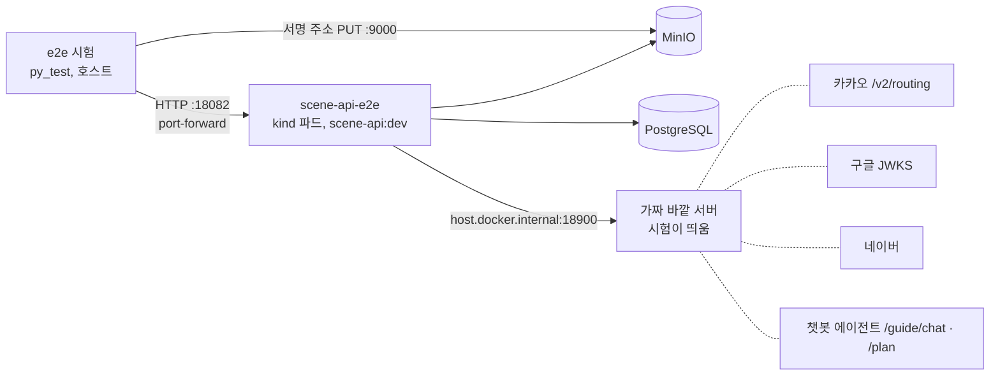

# scene-api API e2e — 배포된 모습 그대로, 바깥만 가짜

- **작성일**: 2026-10-18
- **티켓**: MZ2AZ-496
- **상태**: 1차 완료(2026-10-18) — 시험 107 개, 망가뜨려 실패 확인
- **정한 것**(사용자, 2026-10-18): API e2e 먼저(앱 화면 e2e 는 나중) · 바깥 서비스는 가짜 서버 · 로컬 kind

## 1. 왜 — 지금 시험이 못 보는 것

| 층 | 진짜 | 가짜 | 못 보는 것 |
| --- | --- | --- | --- |
| 단위(`just test`) | 컨트롤러·입력 검사 | DB | SQL·스키마 |
| 통합(`just test-integration`) | PostgreSQL, API 통합 층은 앱 전체(MockMvc) | 바깥 API(`@MockitoBean`) | 컨테이너 이미지·쿠버네티스 설정·비밀값 주입, 진짜 HTTP 서버(톰캣·직렬화 설정), 바깥 API 의 실제 HTTP 왕복(헤더·JSON 모양), MinIO 서명 주소 |
| **e2e(이 문서)** | **컨테이너로 뜬 scene-api, 쿠버네티스 설정, PostgreSQL, MinIO** | 카카오·네이버·구글/애플·챗봇 에이전트 — 우리 쪽에서 띄운 HTTP 가짜 | gateway(nginx) — `tools/aws/integration` 의 `gateway_test` 가 이미 본다 |

e2e 는 「코드가 맞나」가 아니라 **「배포된 묶음이 돌아가나」** 를 본다. 바깥 API 의 가짜는 함수 바꿔치기(`@MockitoBean`)가 아니라
**진짜 HTTP 서버**라서, 우리 클라이언트가 보내는 주소·헤더·JSON 과 받은 JSON 을 읽는 코드가 실제로 돈다.

## 2. 구성



- **scene-api-e2e**: 평소 쓰는 로컬 `scene-api` 와 **따로** 띄우는 두 번째 Deployment(같은 이미지 `scene-api:dev`, 같은 DB). 평소 로컬
  서버의 설정(네이버 실제 호출 등)을 건드리지 않는다. 바깥 주소만 가짜로 바꾸고, 로그인은 운영과 같이 `require-registration=true`.
  `platform/kubernetes/scene-api-e2e/` · `just e2e-up` / `just e2e-down`.
- **가짜 바깥 서버**: 시험 프로세스가 `0.0.0.0:18900` 에 띄우는 파이썬 표준 라이브러리 HTTP 서버. kind 파드는 `host.docker.internal`
  로 호스트에 닿는다(trip-guide 가 이미 이렇게 붙는다). 시험이 답을 정하고, 받은 요청을 확인한다.
- **로그인**: 진짜 `POST /auth/google` 을 탄다. 가짜가 구글 JWKS(공개키)를 내고, 시험이 같은 RSA 키로 ID 토큰을 서명한다(표준 라이브러리만 —
  RSA 서명은 `pow(m, d, n)`). 애플은 1차에서 「설정이 없으면 501」만 본다 — 애플 쪽 비밀키 교환까지 가짜로 만드는 건 2차.
- **챗봇**: 1차는 scene-api ↔ 에이전트 경계를 가짜로 둔다(`SCENETRIP_GUIDE_AGENT_BASE_URL` → 가짜). 진짜 trip-guide + 가짜 LLM 은 2차 —
  trip-guide 의 모델 주소가 `config/model.json` 에 박혀 있어 환경변수로 바꾸는 코드가 먼저 필요하다.
- **시험 실행기**: `//tests/e2e:api_e2e_test`, 파이썬 `py_test`(표준 라이브러리만, rules_python 이미 있음). 태그 `e2e` · `local` ·
  `no-sandbox` · `external` — 빠른 레인·CI 에는 안 들어간다. `just test-e2e`.

## 3. 시험 대상 — 기능 묶음마다 대표 흐름 + 주요 오류

마켓 제외(쓰지 않는 기능). API 마다 모든 오류 경우를 쓰지 않는다 — 그건 단위·통합이 맡는다. e2e 는 「붙어서 도나」.

| 묶음 | 흐름 | 오류 |
| --- | --- | --- |
| 로그인·계정 | 구글 로그인 → 토큰 → `/me` → 갱신 → 로그아웃 후 갱신 거절 | 서명 틀린 ID 토큰 401, nonce 다름 401, 애플 미설정 501, 토큰 없이 `/me` 401 |
| 닉네임·차단 | 닉네임 변경 → `/me` 반영, 남을 차단 → 목록 → 해제 | 같은 닉네임 409 |
| 작품·촬영지·검색 | 목록 → 상세 → 촬영지, `q` 검색, 추천어, `Accept-Language` en | 없는 번호 404, 경도 범위 밖 400 |
| 편의시설 | 범위 목록 → 상세 → 사진 | 없는 번호 404 |
| 리뷰 | 촬영지·편의시설 리뷰 쓰기 → 내 리뷰 → 수정 → 지우기, 사진 올리기(서명 주소 → MinIO PUT → 붙이기) | 비회원 쓰기 401/403 |
| 여행후기 | 글 쓰기 → 목록 → 상세 → 코스 담기(`/saves`) → 내 글 → 지우기 | 남의 글 지우기 404(글이 있다는 것을 알리지 않는다 — 계약) |
| 장바구니·찜 | 비회원 설치 ID 로 담기 → 조회 → 빼기, 작품 찜 | 없는 장소 담기 404 |
| 코스·여행 | 코스 만들기 → 여행 시작 → 진행 → 방문 표시 | 여행 중 아닌데 길찾기 409 |
| 길찾기 | 여행 중 다음 구간 — 가짜 카카오가 대중교통 답 → 응답 legs·walkMeters, 카카오에 간 요청 확인 | 카카오 5xx → 503, 한도 초과 429 + `Retry-After` |
| 챗봇 | 대화 한 턴(가짜 에이전트 답이 앱 모양으로 나옴), 계획 짜기 | 에이전트 죽음 → 503 |
| 신고·업로드·이벤트 | 글 신고, 업로드 주소 받기, 앱 이벤트 기록 | 잘못된 이벤트 400 |
| 공통 | 깨진 JSON 400, 없는 경로 404, 에러 응답 모양(`code`·`traceId`) | |

## 4. 규칙 — 실패를 본 적 없는 시험은 넣지 않는다

시험은 **새 서브에이전트가 계약(`contracts/openapi`)·이 문서만 보고** 쓴다(CLAUDE.md TEST). 구현이 이미 있으니 MZ2AZ-494 처럼
**지키는 동작을 망가뜨려 빨간 것을 본다** — e2e 는 컨테이너가 대상이라, 망가뜨린 코드로 이미지를 다시 굽고 `scene-api-e2e` 에만 올려
본다(여러 시험을 한 번에 묶어 굽는다). 바깥 서비스 쪽 시험은 가짜의 답을 틀리게 바꿔 본다. 망가뜨린 코드는 커밋하지 않는다.
시험이 실제 결함을 찾으면 시험을 고치지 않고 보고한다.

절차 — 평소 서버(`deployment/scene-api`)는 건드리지 않는다:

```
(소스에 버그를 넣고) just image scene-api sabotage
kubectl -n scenetrip set image deployment/scene-api-e2e scene-api=scene-api:sabotage
just e2e-forward          # 파드가 바뀌면 port-forward 가 끊긴다. e2e-up 은 이미지를 dev 로 되돌리므로 쓰지 않는다
just test-e2e             # 겨냥한 시험이 의도한 이유로 빨간지
git checkout -- services/scene-api/src ; set image … scene-api:dev ; just e2e-forward
```

**1차 결과(2026-10-18)**: 시험 108 개 중 106 개가 망가뜨린 서버에서 의도한 이유로 빨간 것을 봤다(이미지 4 번에 버그 100 개 남짓).
약한 시험 1 개 — 「몸통을 바꾼 액세스 토큰」 이 `sub` 를 UUID 꼴이 아닌 값으로 바꿔, 서명 검사를 꺼도 다른 이유로 401 이 났다(서명 검사를
끄면 남의 실제 id 로 바꾼 토큰이 그 사람 계정을 연다). 남의 실제 id 로 바꾸게 다시 썼다. 나머지 1 개는 알려진 실패였는데(`/v1` 밖 경로, §5) 문서를 고치기로 해 지웠다 — 지금 107 개.

## 5. 발견

- **`/v1` 밖 경로가 오류 JSON 이 아니다.** 로컬은 톰캣 기본 HTML 404, PRD 는 gateway 의 빈 text/plain 404. `docs/api/errors.md` 는
  「버전 접두사를 빠뜨리면 `ENDPOINT_NOT_FOUND`」 라고 했다. 사용자 결정(2026-10-18): 동작은 두고 문서를 고친다 — `/v1` 밖은 API 바깥.
  그 시험은 지웠다.
- 계약이 정하지 않은 것(시험은 실제 동작으로 고정). 사용자 결정(2026-10-18)으로 앞의 셋은 계약·`errors.md` 에 적었다: 깨진 JSON 의 코드
  `INVALID_PARAMETER`, 토큰 없는 `/me` 의 코드 `ACCESS_TOKEN_INVALID`, 여행 중 아님 409 의 코드 `COURSE_NOT_ACTIVE`. 나머지는 그대로:
  애플 미설정 501 의 몸체(비어 있다), 리뷰 사진 키가 붙인 뒤 `uploads/tmp/…` →
  `reviews/…` 로 바뀐다(계약은 「응답의 키를 다시 보내면 남는다」 만 약속).
- `ApiError.traceId` — 계약은 500·503 에만 싣는다고 하는데 `errors.md` 예시는 404 에 붙어 있었다. 실제는 계약대로 — 예시를 고쳤다.

## 6. 하지 않는 것(1차)

- 앱 화면 e2e(iOS·Android) — 사용자 결정으로 나중
- gateway(nginx) 경로 — `gateway_test` 가 본다
- 진짜 trip-guide + 가짜 LLM, 애플 로그인 전체 흐름 — 2차
- CI 에서 돌리기 — kind 를 CI 에 띄우는 비용 때문에 ADR 0005 가 미뤄 둔 것. 로컬 `just test-e2e` 로만
- 진짜 바깥 서비스 연결 확인 — 지금처럼 배포 뒤 스모크(`navigation-smoke` 등)
