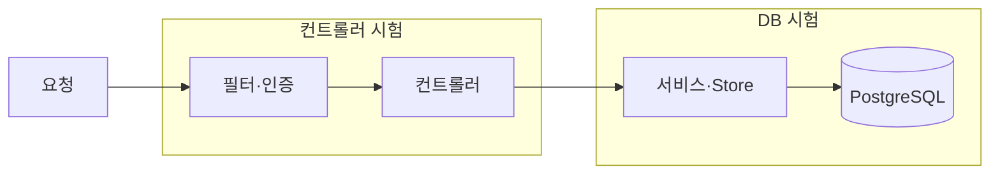

# scene-api API 통합 시험 — 요청부터 실제 DB 까지

- **작성일**: 2026-10-17
- **티켓**: MZ2AZ-494
- **상태**: 1차 완료(2026-10-17) — 시험 37 개, 전부 망가뜨려 실패를 확인함

## 1. 왜

| 지금 있는 시험 | 개수 | 진짜로 쓰는 것 | 가짜로 바꾸는 것 |
| --- | --- | --- | --- |
| 컨트롤러 시험(`@WebMvcTest`, 단위 레인) | 34 | HTTP 요청·응답, 컨트롤러, 입력 검사 | DB 쪽 전부(`@MockitoBean`) |
| DB 시험(통합 레인) | 81 | 실제 PostgreSQL, SQL, Store | HTTP·컨트롤러가 없다 |
| **둘을 이어서** | **0** | | |

그 이음매에서 지난 사고가 났다 — MZ2AZ-166 `q` 없는 목록 조회(`:q IS NULL` 타입 추론 실패, 커밋 `833a432`: 「리포지토리를 모킹한 시험으로는
잡히지 않고 실제 DB 를 불러야 나오는 종류」), MZ2AZ-182 지도 범위 경도 ±180 이 500(PostGIS 가 거부, `d86e927`). 2026-10-17 의 「표출 중단된
관광공사 번호의 상세는 안 나간다」(V38 뷰)도 `PoiStore` 를 직접 불러 확인했을 뿐 `GET /v1/pois/{id}` 로는 시험하지 않았다.

## 2. 무엇

- **바탕**: `@SpringBootTest` + `@AutoConfigureMockMvc`. 앱 전체(필터·컨트롤러·서비스·Store)가 뜨고 MockMvc 로 요청한다.
- **DB**: 지금 통합 시험과 같은 접속(`IntegrationDatabase` — 로컬 kind, CI 서비스 컨테이너). 운영 DB 에 닿는 길이 없다.
- **되돌림**: 시험마다 트랜잭션 안에서 돌고 끝나면 되돌린다(MockMvc 는 요청이 시험과 같은 스레드라 `@Transactional` 이 묶는다). 자기가 만든 행(`TEST-…`)만 확인한다 —
  로컬은 전량 데이터, CI 는 표본이라 전체 개수에 기대지 않는다.
- **가짜**: 바깥 API 만 — 카카오 길찾기, 챗봇 에이전트, 사진 저장소(S3).
- **새 라이브러리 없음**: `spring-boot-starter-test`(MockMvc · JUnit · AssertJ · Mockito)와 이미 쓰는 `spring-boot-webmvc-test`.
- **레인**: 통합(`integration` 태그). `just test-integration //services/scene-api:…`.

| 묶음 | 특히 볼 것 |
| --- | --- |
| 작품·촬영지·검색 | `q` 있음·없음, 언어 폴백, 빈 결과, 경도 ±180 범위 |
| 편의시설 | 목록·상세, 표출 중단된 관광공사 번호의 상세·사진이 응답에서 빠짐 |
| 로그인·내 정보 | 토큰 → 회원 창구, 닉네임 중복이 DB 제약에서 409 |
| 장바구니·찜·코스 | 비회원 설치 ID 로 담기 → 조회 → 지우기 |
| 리뷰·여행후기 | 올리기 → 붙이기 → 목록·상세 → 지우기 → 사진 지우기 목록 |
| 유료 한도 | 길찾기·챗봇의 N+1 번째가 실제 DB 카운터로 429 와 `Retry-After` |
| 신고·차단·마켓 | 차단한 사용자의 글·리뷰가 목록에서 빠짐 |
| 공통 오류 | 깨진 JSON 400, 검증 실패 400, 없는 경로 404 — 앱 전체 설정으로 |

## 3. 규칙 — 실패를 본 적 없는 시험은 넣지 않는다

명세(계약 `contracts/openapi`, 이 문서, 공개 시그니처)만 보고 쓴다. 저장소 규칙(CLAUDE.md TEST)은 「새 시험은 구현 전에 실패해야 한다」 인데, 이번에는
구현이 이미 있다. 그래서 **시험마다 그 시험이 지키는 동작을 잠깐 망가뜨려 의도한 이유로 빨간 것을 확인하고 되돌린다**(예: 오류 처리기 등록을 빼면
400 시험이 500 을 보고 실패, 뷰 대신 원래 표를 읽게 하면 표출 중단 시험이 실패). 망가뜨린 코드는 커밋하지 않는다. 실패를 못 본 시험은 지운다.
시험이 실제 결함을 찾으면 시험을 고치지 않고 보고한다.

## 4. 하지 않는 것

- 기존 시험 변경
- 「앱이 기동하며 마이그레이션을 하는가」(MZ2AZ-176 Flyway 사고 종류) — 시험 DB 를 미리 마이그레이션해 두는 구조라 빈 DB 를 쓰는 시험이 따로 필요하다
- 배포 후 실제 요청 확인(SMOKE)의 대체 — 실행 환경에만 있는 문제(MZ2AZ-182 추적 ID 는 운영 에이전트에서 왔다)는 이 시험으로 못 잡는다
