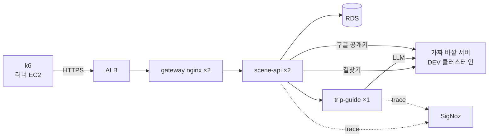

# DEV 부하 테스트 — 우리 서버는 진짜, 바깥만 가짜

- **작성일**: 2026-10-18
- **티켓**: MZ2AZ-502
- **상태**: 문제 찾기(2단계)까지 끝 — 실험 01~09(2026-10-18, 시나리오 v1·v2). 다음은 해결: 사례 A(쿼리 줄이기)·사례 B(연결 풀 → gateway 연쇄).
  DEV 는 아직 시험 모드(끄기 전까지 진짜 구글 로그인 안 됨)
- **기록**: 실험마다 [docs/qa/loadtest/](../../qa/loadtest/README.md) 에 남긴다(포트폴리오용 — 경위·정의·원인·해결·검증과 이전·이후 수치)

## 1. 왜

PRD 는 2026-10-13 에 올라갔고 사용자가 아직 적다(하루 요청 약 1.7 만, 대부분 바깥 감시). 사용자가 늘 때 **어느 요청이, 몇 명쯤에서, 왜 느려지는가**를
미리 알아야 한다. DEV 는 처음부터 이 용도로 SigNoz 를 넣었다([ADR 0025](../../architecture/adr/0025-aws-observability-signoz-in-eks.md)) —
「느려졌다」 가 아니라 「DB 쿼리인지, 커넥션 대기인지, 바깥 호출인지」 를 trace 로 가른다.

## 2. 정한 것 (사용자, 2026-10-18)

| 무엇 | 정한 것 | 이유 |
| --- | --- | --- |
| 도구 | **k6** | 시나리오를 JS 로 짧게, p50·p95·p99 를 기본으로. 단일 실행 파일이라 Bazel 로 받기 쉽다 |
| 부하를 보내는 곳 | **서울 리전 EC2**(러너 `i-05785c5441a8bb817`, t3.large) | 집 회선·노트북이 먼저 한계에 닿으면 서버 문제와 구분이 안 된다 |
| 무엇이 진짜인가 | gateway · scene-api · PostgreSQL(RDS) · trip-guide **전부 진짜** | 우리 서버의 문제는 그대로 드러나야 한다 |
| 무엇이 가짜인가 | **바깥 회사 서버만** — Bedrock(LLM)·카카오 길찾기 (뒤에 더함: 구글 공개키 — 로그인 행, 네이버 장소 검색 — 실험 05 뒤 가짜를 만들었으나 시험에서는 링크 찾기 자체를 껐다) | 돈이 들고(카카오는 호출 한도도), 우리가 고칠 수 없다 |
| 로그인 | 시험 동안만 DEV 의 구글 공개키 주소를 가짜로 → k6 가 가짜 키로 ID 토큰을 만들어 **진짜 `/auth/google`** 을 탄다 | e2e(MZ2AZ-496)에서 검증한 방법. 운영 코드에 시험용 구멍을 만들지 않는다. 그동안 DEV 의 진짜 구글 로그인은 안 된다 — 끝나면 되돌린다 |

## 3. 구성

실제로 시험한 DEV 는 gateway·scene-api·trip-guide 가 **각 1 대**다(아래 그림의 ×2 는 처음 계획 때 PRD 를 본뜬 것 — 그대로 둔다). 실험 기록의
수치는 모두 1 대 기준이다.



### 가짜 바깥 서버 — 무엇을 흉내 내나

가짜가 흉내 낼 것은 바깥 서버의 **겉모습** 셋이다. 우리 코드가 그 응답을 읽고 처리하는 과정은 진짜다.

1. **응답 모양** — 카카오·Bedrock 이 실제로 주는 JSON 그대로(e2e 가짜의 모양을 재사용).
2. **응답 시간** — PRD SigNoz 의 실측 분포(p50·p95)를 그대로 흉내. 「항상 2 초」 가 아니다. 실측값은 준비 단계에서 잰다.
3. **(선택) 가끔의 실패** — 일정 비율로 느리거나 5xx — 바깥이 흔들릴 때 우리가 버티는지.

가짜 자체가 병목이 아닌지 따로 확인한다(가짜만 단독으로 두드려 본다).

#### PRD 실측 — 가짜가 흉내 낼 값 (2026-10-18, PRD SigNoz ClickHouse 직접 조회, 최근 7 일)

| 바깥 호출 | 건수 | p50 | p95 | 최대 | 비고 |
| --- | --- | --- | --- | --- | --- |
| Bedrock `chat openai.gpt-oss-120b-1:0` (trip-guide → LLM) | 4 | 2.58 초 | 5.34 초 | 5.83 초 | 4 건 모두 일정짜기 마법사(`/guide/plan`) — 요청 한 번에 LLM 1 번 |
| scene-api → trip-guide `POST` (에이전트 한 턴 전체) | 4 | 2.91 초 | 6.17 초 | 6.75 초 | LLM 시간 + 에이전트가 scene-api 를 6~16 번 읽음(각 12~68ms) |
| 카카오 길찾기 `GET dapi.kakao.com` | 11 | 65ms | 502ms | 608ms | 대중교통·도보 섞임 |
| 구글 공개키 `GET www.googleapis.com` | 4 | 119ms | 227ms | 245ms | 캐시가 비었을 때만 |

**한계**: 표본이 작다 — PRD 사용자가 아직 적고, 2026-10-17 20:50~23:50 은 SigNoz 디스크가 차서 기록이 없다. 챗봇 대화(`/guide/chat`)
턴은 표본이 없어 한 턴의 LLM 호출 수(도구를 쓰면 2~4 번)는 코드 설계값(`agents/trip-guide`, 최대 3 회 왕복)으로 둔다. DEV SigNoz 에는 바깥 호출
기록이 없다(쓴 적이 없다). 사용자가 늘면 다시 재서 가짜 값을 고친다.

**가짜에 넣을 값**: LLM 한 번 = 평균 약 2.6 초, 꼬리 약 5.5 초(로그정규 근사) · 카카오 = 평균 약 70ms, 꼬리 약 0.5 초 · 구글 공개키 = 120ms.

### 주소 바꾸기

| 바깥 | 지금 | 할 일 |
| --- | --- | --- |
| 카카오 길찾기 | 설정으로 바꿀 수 있다(`scenetrip.navigation.kakao.base-url`) | DEV 시험 중에만 가짜로 |
| 구글 공개키 | 설정(`scenetrip.auth.google.jwks-uri`·`client-ids`) | 같음 |
| Bedrock(LLM) | 환경변수로 덮는다(`TRIP_GUIDE_MODEL_BASE_URL`·`TRIP_GUIDE_MODEL_AUTH=none`, [trip-guide README](../../../agents/trip-guide/README.md)) — 전에는 `config/model.json` 에 박혀 있었다 | 같음 |

### 시험 모드 켜고 끄기

명령 하나로 켜고 끈다 — 켜면 위 세 주소를 가짜로, 끄면 원래대로. 차트의 `loadtest` 값 묶음(기본 꺼짐)이 하는 일은
[차트 README](../../../platform/helm/scenetrip/README.md)의 「DEV 부하 시험 모드」 에 있다: 가짜 바깥 서버(`fake-external`)와
통로(NetworkPolicy), 세 주소 덮기, gateway IP 상한을 2000r/s · burst 4000 · 동시 4000 으로. **PRD 에서 켜면 차트 렌더가 실패하고, 명령도 dev 만 받는다.**

```bash
# 0) 시험 회원 토큰과 공개키(한 번) — 비밀키 파일은 저장소 밖에 둔다
just load-tokens --key ~/.scenetrip-load/google-key.json --jwk-out ~/.scenetrip-load/jwk.json \
  --count 2000 --aud load-test.apps.googleusercontent.com --out ~/.scenetrip-load/tokens.json

# 1) 켜기 — DEV 클러스터 접속(아래)이 열려 있어야 한다
LOADTEST_GOOGLE_CLIENT_ID=load-test.apps.googleusercontent.com \
LOADTEST_GOOGLE_JWK=~/.scenetrip-load/jwk.json \
  just loadtest-mode dev on

# 2) 끄기 — 시험이 끝나면 반드시
just loadtest-mode dev off
```

- **입력**: on 은 `LOADTEST_GOOGLE_CLIENT_ID`(토큰의 `--aud` 와 같은 값)와 `LOADTEST_GOOGLE_JWK`(**공개** JWK 파일 경로)가 필요하다. off 는 필요 없다.
  `LOADTEST_KUBE_CONTEXT` 로 컨텍스트를 고를 수 있고, 어느 쪽이든 이름이 `cluster/scenetrip-dev` 로 끝나야 한다.
- **하는 일**: 고정 helm(`//tools/bazel/cloud:helm`)으로 `helm upgrade scenetrip platform/helm/scenetrip -n scenetrip --reset-then-reuse-values
  --set loadtest.enabled=true|false …(--set-file loadtest.googleJwkJson=<파일>) --atomic --wait`. 깔린 값(이미지·DB·도메인)은 그대로다.
  `--reuse-values` 가 아니라 `--reset-then-reuse-values` 인 까닭: `--reuse-values` 는 옛 차트의 기본값을 써서, `loadtest` 를 모르는 차트로 깔린
  릴리스에서는 새 기본값(상한 2000r/s 등)이 빠진다. 대신 **이 체크아웃의 차트가 DEV 에 깔린 차트와 같은 커밋이어야 한다** — 다르면 그 차이도 함께 올라간다.
- **파드 재시작**: scene-api·gateway 는 설정 checksum 이, trip-guide 는 파드 환경변수가 바뀌어 다시 뜬다(trip-guide 는 메모리 세션이라 대화가 초기화된다).
  scene-api 가 다시 뜨므로 구글 공개키 캐시도 비워진다.
- **보통 배포가 끈다**: `just aws-apply dev`(GitHub Actions aws-deploy)는 Helm 값을 처음부터 다시 넣으므로 시험 모드는 꺼진 상태로 돌아간다.
  시험 중에 DEV 배포를 돌리지 않는다.
- **그동안**: DEV 의 진짜 구글 로그인은 안 된다(시험 토큰의 aud 하나만 받는다). 카카오 가짜는 `KakaoAK` 헤더가 없으면 401 이므로 DEV 의
  `KAKAO_REST_KEY` 가 비어 있으면 길찾기는 가짜 전에 503 이다.

**DEV 클러스터 접속 — 명령이 스스로 열지 않는다.** DEV EKS API 는 러너의 고정 IP 에서만 받는다(노트북에서는 시간 초과). 그래서 시험 전에 사람이 연다.

1. 임시 EKS 접근 항목: 내 IAM 주체에 DEV 클러스터 권한을 준다 — `aws eks create-access-entry --cluster-name scenetrip-dev --principal-arn <내 ARN>`
   + `aws eks associate-access-policy … --policy-arn arn:aws:eks::aws:cluster-access-policy/AmazonEKSClusterAdminPolicy --access-scope type=cluster`.
2. `aws eks update-kubeconfig --name scenetrip-dev --region ap-northeast-2` 로 컨텍스트를 만든다.
3. 러너를 거치는 SSH SOCKS 터널: `ssh -D 1080 -N <러너>` 를 열어 두고 `export HTTPS_PROXY=socks5://127.0.0.1:1080`. 명령은 이 값을 helm·kubectl 실행에만
   넘기고 Bazel 이 도구를 준비할 때는 뺀다.
4. 시험이 끝나면 `just loadtest-mode dev off` → 터널을 닫고 → `aws eks delete-access-entry --cluster-name scenetrip-dev --principal-arn <내 ARN>`.

## 4. 부하를 막는 장치 — 먼저 알고 간다

부하는 EC2 **한 대(IP 하나)** 에서 나간다. 그래서 운영용 안전장치에 먼저 걸린다.

| 장치 | 기준 | 시험에 미치는 것 | 처리(정할 것) |
| --- | --- | --- | --- |
| gateway 초당 30 회(+60 몰림) | **IP 마다**, gateway 파드마다 | 한 IP 라 전체가 초당 약 30~60 회에서 429 | DEV 시험 중에만 올리거나, 이 한도 자체를 첫 실험으로 확인 |
| scene-api 분당 120(회원)·60(비회원) | 사용자·설치 ID 마다, 파드마다 | k6 가상 사용자마다 다른 설치 ID·회원이면 걸리지 않는다 | 가상 사용자마다 따로 |
| 길찾기 분당 10·하루 300, 챗봇 시간당 15·하루 100 | 사용자마다, DB | 같은 회원으로 몰면 막힌다 | 회원을 많이 만들거나 DEV 만 한도를 올린다 |

## 5. 시나리오 (초안)

실제 앱 흐름을 본뜬다. 비중은 PRD 트래픽이 쌓이면 맞춘다.

| 흐름 | 요청 | 비중(초안) |
| --- | --- | --- |
| 둘러보기(비회원) | 작품 목록 → 상세 → 촬영지 → 검색 추천어 → 편의시설 지도(bbox) | 60% |
| 담기(비회원) | 장바구니 담기·조회·빼기, 찜 | 15% |
| 여행(회원) | 로그인 → 코스 만들기·시작 → **길찾기**(가짜 카카오) | 15% |
| 챗봇(회원) | 대화 한 턴(가짜 Bedrock 약 2 초) | 10% |

단계: ① 연기 확인(1 명) → ② 기준(평소 부하) → ③ 계단식 증가(무너지는 지점 찾기) → ④ 오래 버티기(30 분, 메모리·커넥션 누수).

## 6. 무엇을 재나

| 어디 | 지표 |
| --- | --- |
| k6 | 초당 처리량, 응답 시간 p50·p95·p99, 오류율(상태 코드별) |
| SigNoz | 느린 요청의 trace(어느 구간에서 시간을 썼나), 서비스별 지연·오류, DB 쿼리 시간 |
| AWS | RDS CPU·커넥션 수·읽기 지연, 노드 CPU(CloudWatch), ALB 지연·5xx |
| 쿠버네티스 | 파드 재시작·OOM(메모리 부족 종료) |

## 7. 진행 순서

0. **준비** — 이 문서 확정 · 기록 양식([docs/qa/loadtest/](../../qa/loadtest/README.md)) · 가짜 바깥 서버(DEV 배포) · trip-guide 모델 주소 환경변수 ·
   시험 모드 켜고 끄는 명령 · k6 를 Bazel 로 받기(`MODULE.bazel`, `just test-load`) · DEV 에 PRD 수준 데이터 적재(확인해 보니 필요 없었다 — 작품·촬영지·편의시설이 PRD 와 거의 같음, [준비 일지 §6](../../qa/loadtest/00-준비.md)) · PRD 의 Bedrock·카카오 응답 시간 실측
1. **기준 측정** — 「이전」 수치
2. **문제 찾기** → 3. **정의** → 4. **원인** → 5. **해결**(시험 먼저) → 6. **검증**(같은 조건으로 「이후」)

## 8. 정할 것

- ~~gateway IP 한도~~ → **DEV 시험 중에만 올린다**(사용자 2026-10-18)
- ~~유료 한도~~ → **시험 회원을 수백 명 만들어 나눈다**(실제 사용자처럼 사람마다 따로 — 실험에서는 2,000 명)
- ~~k6 의존성~~ → **추가함**(v2.3.0, SHA-256 고정 — 이전·이후를 같은 도구로 재려고)
