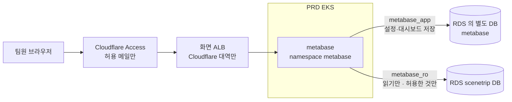

# PRD 데이터 보기 — Metabase 를 EKS 안에, 읽기 전용 계정으로, Cloudflare Access 뒤에

- **상태**: 계획(2026-10-21) — 확인 전에는 코드를 쓰지 않는다
- **관련**: [ADR 0027](../../architecture/adr/0027-metabase-in-eks-read-only.md)(제안) · [ADR 0025](../../architecture/adr/0025-aws-observability-signoz-in-eks.md)(SigNoz — 같은 모양) ·
  [observability-aws.md](observability-aws.md) · [aws-dev-prd.md](../../architecture/aws-dev-prd.md) · `tools/aws/db-bootstrap.sh`

## 1. 왜

PRD 데이터(작품·촬영지 이용, 장바구니·코스·후기, 사용 기록)를 표·그래프로 보고 싶다. 지금은 DB 를 보려면 클러스터 안에 psql 파드를 띄워 SQL 을
손으로 친다. 팀이 같이 쓰고, 대시보드를 저장해 두고 다시 볼 수 있어야 한다.

## 2. 지금 (저장소·AWS 확인)

| 대상 | 지금 |
| --- | --- |
| PRD DB | RDS PostgreSQL, DB subnet(인터넷 경로 없음). 5432 는 workload 보안 그룹에서만 |
| DB 계정 | `app_migrate`(구조 변경), `app_runtime`(앱, SELECT·INSERT·UPDATE·DELETE 전부) 둘뿐 — `tools/aws/db-bootstrap.sh`. **읽기 전용 계정이 없다** |
| 개인정보가 든 표 | `app_user`·`user_identity`(소셜 계정)·`user_device`(설치 ID)·`refresh_token`·`guide_turn`(챗봇 대화)·`user_event`·`search_log` 등 |
| 관측 화면의 선례 | SigNoz: 공식 이미지를 환경 ECR 로 복사(digest 고정), 화면 전용 ALB(보안 그룹은 Cloudflare 대역만) → Cloudflare Access(허용 메일만) |
| PRD 노드 | Auto Mode, requests 로 노드 수를 정함. 용량을 안 보고 SigNoz 를 넣었다가 502 사고(2026-10-13) — 넣기 전 `describe node` 확인 필수 |
| Metabase | 저장소에 아무것도 없다 |

## 3. 구성

### 3-1. DB 계정 두 개 (`db-bootstrap.sh` 에 더한다 — 몇 번 돌려도 같게)

| 계정 | 권한 | 왜 |
| --- | --- | --- |
| `metabase_app` | 별도 DB `metabase` 의 주인. `scenetrip` DB 에는 접속 권한 없음 | Metabase 가 자기 설정·대시보드·사용자를 저장할 곳. 기본 내장 DB(H2)는 파드가 바뀌면 날아가 운영에 쓰지 말라고 공식 문서가 권한다 |
| `metabase_ro` | `scenetrip` DB 의 **`analytics` 스키마만** SELECT. `public` 스키마 권한 없음 | 실수로 쓰지 못하고, 개인정보 표를 직접 못 본다 |

`metabase_ro` 에 거는 안전장치(PRD 주 DB 를 같이 쓰므로):
- `ALTER ROLE metabase_ro CONNECTION LIMIT 5`
- `ALTER ROLE metabase_ro SET statement_timeout = '30s'` — 무거운 질의가 앱을 막지 않게
- `ALTER ROLE metabase_ro SET default_transaction_read_only = on`

### 3-2. 무엇을 보여 주나 — `analytics` 스키마의 뷰

`public` 의 표를 그대로 열지 않고, **보여 줄 칸만 고른 뷰**를 `analytics` 스키마에 만든다(Flyway 마이그레이션 — 표가 바뀌면 뷰도 같은 PR 에서 고친다).

| 묶음 | 뷰에 넣는 것 | 빼는 것 |
| --- | --- | --- |
| 작품·촬영지·편의시설 | 이름(ko·en)·분류·인기도·숨김 여부 | — |
| 이용 | 날짜·대상별 조회 수(`entity_daily_stats`), 장바구니·찜·코스·후기 **개수**(날짜·대상별) | 설치 ID·사용자 ID·본문 |
| 계정 | 날짜별 가입·로그인 수, 소셜 종류별 수 | 이메일·이름·소셜 ID·토큰·기기 |
| 챗봇 | 날짜별 대화 턴 수·실패 수 | 대화 내용 |

어떤 뷰를 처음에 만들지는 **보고 싶은 질문 목록**으로 정한다(§6 결정 1).

### 3-3. Metabase 띄우기

- 이미지: 공식 오픈소스 `metabase/metabase`, 버전·digest 고정, 환경 ECR 로 복사(SigNoz 와 같은 방식, `tools/aws/config.py`)
- Helm: 외부 차트를 쓰지 않고 `platform/helm/metabase/` 에 Deployment·Service·Ingress·NetworkPolicy 를 직접 쓴다(부품 하나라 차트가 필요 없다)
- 자원: requests 메모리 1Gi·CPU 250m, limits 메모리 2Gi(JVM). **넣기 전 PRD 노드 Allocated 확인** — 모자라면 Auto Mode 가 노드를 하나 더한다(비용)
- 비밀값: `metabase_app` 암호, `MB_ENCRYPTION_SECRET_KEY`(Metabase 가 저장하는 연결 암호를 암호화) — Secrets Manager → 배포 때 동기화
- 네트워크: 파드는 ALB 대역에서만 받고, 나가는 것은 RDS 5432 만
- 화면: SigNoz 화면 ALB 를 같이 쓸 수 있으면(IngressGroup) 같이 쓰고, 안 되면 같은 방식의 ALB 를 하나 더 — **Auto Mode 에서 묶기 되는지 DEV 에서 먼저 확인**
- 도메인: `metabase.scenetrip.io`(Cloudflare, 프록시 켬) + Cloudflare Access 앱(허용 메일 — 저장소에 적지 않는다). Metabase 자체 로그인도 그대로 둔다(두 겹)

## 4. 순서

1. 이 계획·ADR 확인
2. Flyway: `analytics` 스키마와 첫 뷰(테스트 먼저 — 뷰에 개인정보 칸이 없는지, `metabase_ro` 로 `public` 을 못 읽는지 통합 테스트)
3. `db-bootstrap.sh`: 두 계정·별도 DB·권한(테스트 먼저)
4. Helm·이미지 복사·Terraform(필요하면 ALB 보안 그룹)·배포기
5. **DEV 에 올려 확인** — 화면 접속, 질문 하나를 대시보드로, `metabase_ro` 로 `public.app_user` 읽기 실패 확인
6. **PRD 적용은 따로 확인을 받고** — 노드 용량 확인 → 적용 → 바깥 감시 알람·앱 응답 확인

## 5. 하지 않는 것

- 읽기 전용 복제 DB(돈) — 질의가 무거워져 앱에 영향이 보이면 그때
- 개인정보 칸을 Metabase 에서 가리는 기능(Metabase 설정)에 기대기 — DB 권한으로 막는다
- Metabase 유료 기능(SSO·감사 로그)

## 6. 정할 것

1. 처음에 답하고 싶은 질문 3~5 개(예: 일별 활성 설치 수, 많이 본 작품·촬영지, 장바구니 → 코스 전환, 챗봇 사용량)
2. 화면 주소 `metabase.scenetrip.io` 와 허용 메일(SigNoz 와 같은 세 명?)
3. 노드가 하나 늘면 드는 비용을 받아들일지(어림 — 넣기 전 실제 Allocated 로 다시 계산)
