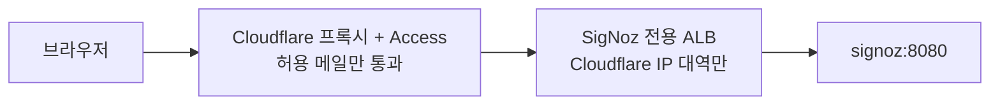

# AWS 관측 — DEV·PRD 에 SigNoz, 바깥 감시 알람 두 개, Cloudflare Access 로 UI

- **상태**: 계획(2026-10-13, 권호)
- **관련**: [ADR 0025](../../architecture/adr/0025-aws-observability-signoz-in-eks.md) · [prd-launch.md](prd-launch.md) §1 「모니터링·알람·비용 상한」 · [ADR 0004](../../architecture/adr/0004-opentelemetry-javaagent.md)(Java OTEL 에이전트) ·
  [aws-dev-prd.md](../../architecture/aws-dev-prd.md) §텔레메트리 · [dev-lifecycle.md](dev-lifecycle.md) · [aws-deployment.md](../../ops/aws-deployment.md)

## 1. 왜

PRD 는 2026-10-13 에 올라갔고 데이터까지 들어갔다. 그런데 **AWS 에는 관측 도구가 하나도 없다** — 서버가 죽거나 DB 가 차도 사용자가
말해 주기 전에는 모른다. SigNoz 는 로컬(kind)에만 있고, AWS 로 옮길 때 범위에서 빠진 채 남았다(따로 내린 결정은 없다,
`aws-dev-prd.md:199` 「수집기를 설치하지 않은 상태면 Java OTEL 을 끈다」).

DEV 에서 **부하 테스트**를 할 예정이다. 「느려졌다」 는 CloudWatch 로도 보이지만 「왜 — DB 쿼리인지, 외부 호출(카카오·Bedrock)인지,
커넥션 풀인지」 는 요청을 단계별로 쪼갠 trace 가 있어야 보인다.

## 2. 실측 (2026-10-13, 읽기만)

| 대상 | 지금 |
| --- | --- |
| scene-api | Helm `otel.endpoint` 가 비어 있으면 `OTEL_SDK_DISABLED=true`(`templates/config.yaml:23`). 값을 주면 OTLP gRPC 로 보내고, 4317 로 나가는 네트워크 정책도 같이 생긴다(`templates/network-policy.yaml:106`) |
| trip-guide | OpenTelemetry 가 **전혀 없다**(`agents/trip-guide/src` 에 계측 코드 없음) |
| 로컬 SigNoz | `tools/scripts/cluster-up.sh` 가 **foundry 설치 스크립트**(`curl … foundry.sh \| bash`)로 깐다 — 버전이 고정되지 않고 Bazel 밖이다. AWS 에는 그대로 못 쓴다 |
| EKS | Auto Mode(`eks.tf:29`, 노드 풀 `general-purpose`·`system`) — 자리가 모자라면 AWS 가 노드를 더한다 |
| EKS API | 러너 IP(`15.165.195.27/32`)에서만 열린다 — 노트북에서 `kubectl port-forward` 로 UI 를 볼 수 없다 |
| 권호 노트북 IP | 유동 — 허용 IP 방식은 쓸 수 없다 |
| DNS | `scenetrip.io` 는 Cloudflare. `api.scenetrip.io` 는 DNS only(프록시 꺼짐) |

## 3. 결정

| 항목 | 결정 | 이유 |
| --- | --- | --- |
| 어디에 | **DEV·PRD 둘 다** EKS 안에 SigNoz 직접 설치 | 로컬과 같은 도구·같은 눈. SigNoz Cloud 는 부하 테스트 때 데이터가 한꺼번에 쌓여 요금이 튀기 쉽다 |
| 설치물 | SigNoz 공식 Helm 차트를 **버전 고정**해 Bazel(`http_file`, sha256)로 받는다. 이미지는 ECR 로 복사해 그 주소를 쓴다 | 헤르메틱·재현성. Docker Hub 받기 한도에 배포가 걸리지 않게 |
| 설치 주체 | 배포기(`tools/aws`)가 앱 Helm 과 같은 실행에서 `signoz` 네임스페이스에 설치 | 사람 손 설치 금지. 배포 역할에 `signoz` 네임스페이스 권한만 더한다 |
| 저장 공간 | ClickHouse 등은 EBS(gp3) PVC. **DEV 는 내리면 같이 지운다**, **PRD 는 남긴다** | DEV 는 부하 테스트용 — 남길 이유 없음 |
| 보관 기간 | trace·로그 **7 일**, 지표 **30 일**(PRD). DEV 는 차트 기본값 | 디스크 상한을 정해 둔다. 실측 뒤 조정 |
| 보내는 쪽 | scene-api: `otel.endpoint` 에 SigNoz 수집기 주소. trip-guide: Python OpenTelemetry 계측을 새로 붙인다(2 차) | scene-api 는 스위치만 켜면 된다 |
| **UI 접근** | **Cloudflare Access** — `signoz.scenetrip.io`(Cloudflare 프록시 켬) → Access 가 허용한 메일만 통과(구글 로그인·메일 코드) → ALB → SigNoz. **ALB 는 Cloudflare IP 대역에서 온 요청만** 받는다. SigNoz 자체 로그인도 그대로 | IP 가 바뀌어도 된다. 주소를 알아도 Access 를 건너뛸 수 없다. 무료(50 명). `api.scenetrip.io` 는 그대로 DNS only |
| DEV UI | `signoz-dev.scenetrip.io` — 같은 방식 | |
| **알람 — 바깥 감시** | AWS 쪽에 두 개만: ① **ALB 정상 대상 0**(CloudWatch 알람) ② **월 비용 예측 초과**(AWS Budgets). 둘 다 SNS → 메일 | SigNoz 가 같은 클러스터에 있으면 클러스터가 통째로 죽을 때 알람도 같이 죽는다 — 「서버가 죽었다」 는 바깥에서 본다 |
| 알람 — 세부 | SigNoz 알람: 5xx 비율, p95 지연, DB 연결 오류, 챗봇 `GUIDE_UNAVAILABLE`·`RATE_LIMITED` 비율 | 원인 단위 알람은 trace·지표가 있는 곳에서 |
| 알람 받는 곳 | 메일(권호). 받는 주소는 **Terraform 변수**로 — 저장소에 적지 않는다 | |

## 4. 나중의 어드민 페이지

같은 Cloudflare Access 를 **운영자용 화면**(어드민)에 그대로 쓴다 — Access 애플리케이션 하나를 더하고 허용 메일을 정하면 된다.
단, **문지기만 믿지 않는다**: Access 는 통과한 요청에 서명된 토큰(`Cf-Access-Jwt-Assertion` 헤더)을 붙인다. 어드민 API 는 서버가
이 토큰의 서명·대상(aud)·메일을 직접 검증하고, 그 위에 서버의 권한 검사를 둔다. 네트워크 경로만으로 권한을 정하지 않는다.
일반 사용자 API(`api.scenetrip.io`)에는 쓰지 않는다 — 앱 사용자는 자기 로그인(JWT)으로 들어온다.

## 5. 사람이 할 일

| 할 일 | 언제 |
| --- | --- |
| Cloudflare Zero Trust 를 켜고 팀 이름 정하기(무료 플랜) | 3 단계 전 |
| Access 정책의 허용 메일 정하기(권호, 필요하면 태환님·승길님) | 3 단계 전 |
| 월 비용 알림 기준 금액 정하기 | 4 단계 전 |
| SNS 구독 확인 메일의 「Confirm」 누르기 | 4 단계 직후 |
| 첫 접속 때 SigNoz 관리자 계정 만들기(DEV·PRD 각각) | 설치 직후 |

## 6. 순서

1. 이 문서 → ADR(「AWS 관측은 EKS 안 SigNoz + 바깥 감시 두 개 + Cloudflare Access」) — 승인
2. **DEV 1 차**: SigNoz 차트·이미지 고정(MODULE.bazel), 배포기 설치·제거, dev 올리기/내리기에 포함, scene-api `otel.endpoint` 켜기,
   Cloudflare Access + `signoz-dev` 주소 → dev 올려 실제 요청이 SigNoz 에 trace 로 보이는지 확인 → **부하 테스트 가능**
3. **trip-guide 계측**: Python OpenTelemetry — 챗봇 한 턴이 Bedrock 호출까지 trace 로 이어지는지 확인
4. **PRD**: SigNoz(보관 기간·PVC 유지) + 바깥 감시 알람 두 개(CloudWatch·Budgets·SNS) → 알람을 일부러 한 번 울려 메일이 오는지 확인
5. SigNoz 세부 알람 — 부하 테스트에서 본 평소 값을 기준으로 문턱을 정한다

## 6-1. 조사 뒤 바뀐 것 (2026-10-13)

차트 0.145.0 을 받아 `helm template` 으로 확인했다.

- ~~관리자 계정 자동 생성(`SIGNOZ_USER_ROOT_*`)은 쓰지 않는다~~ — **틀렸다(2026-10-13 DEV 실측).** SigNoz 는 조직(첫 관리자)이
  있어야 수집기에 설정을 내려준다(opamp). 관리자가 없으면 서버가 「cannot create agent without orgId」 로 거절하고, 수집기는
  받는 포트(4317)를 열지 않아 scene-api 의 trace 가 전부 버려졌다. 그래서 **배포가 관리자를 만든다** — 아이디 `admin@scenetrip.io`
  (메일을 보내지 않는 로그인 아이디), 비밀번호는 Secrets Manager `/scenetrip/<env>/signoz` 에 배포가 한 번 만들고 다시 쓴다.
  팀원은 SigNoz 안에서 초대한다. 화면은 여전히 Cloudflare Access 뒤에만 연다.
- **ClickHouse 비밀번호는 Secrets Manager 대신 클러스터 Secret** — 사람이 쓸 값이 아니고 디스크와 수명이 같다. 차트 기본값은 모든
  설치에 같은 문자열이라 반드시 바꾼다.
- **보관 기간은 values 로 정할 수 없다**(화면·API 만). DEV 는 기본값(trace·로그 15 일, 지표 30 일), PRD 에서 API 로 줄인다.
- 차트가 클러스터 전체에 까는 것: ClickHouse CRD 3 개(Altinity), 읽기 전용 ClusterRole 1 개. DaemonSet·hostPath·특권 없음.

## 6-2. 2 단계 ②: 화면 주소 — Cloudflare Access (2026-10-13)

1 차(①)는 DEV 에서 끝났다 — 올리기 검증이 span 104 개를 셌다. 화면은 아직 클러스터 밖에서 닿지 않는다.

| 항목 | 결정 |
| --- | --- |
| ALB | API 와 **따로**. API ALB 는 인터넷 전체(ADR 0024), 이것은 Cloudflare IP 대역만 — 보안 그룹이 ALB 단위라 나눈다 |
| 보안 그룹 | Terraform `aws_security_group.signoz_alb` — 들어옴: Cloudflare IPv4 대역(https://www.cloudflare.com/ips-v4 를 Terraform 에 고정, 15 개) 443. 나감: 클러스터 SG 8080. 클러스터 SG 에 「SigNoz ALB → 8080」 |
| Ingress | `signoz` 네임스페이스, IngressClassParams `scenetrip-<env>-signoz-alb`(인증서·internet-facing), 대상 `signoz:8080`(ip). 배포기가 SigNoz 설치 뒤 만든다 |
| 인증서 | ACM `signoz-dev.scenetrip.io`(PRD 는 `signoz.scenetrip.io`) — API 인증서처럼 사람이 한 번 요청하고 Cloudflare CNAME 으로 검증, Terraform 변수 `signoz_certificate_arn` 으로 받는다 |
| DNS | 올리기(`lifecycle.up`)가 `signoz-dev` CNAME 을 SigNoz ALB 로 — **프록시 켬**(API 는 DNS only 그대로) |
| Access | 애플리케이션 `signoz-dev.scenetrip.io` + 정책(허용 메일). 주소에 묶이므로 **한 번 만들면 DEV 를 내렸다 올려도 그대로** — Cloudflare API 로 한 번 만든다. 허용 메일은 저장소에 적지 않는다 |
| 로그인 | Access 의 One-time PIN(메일 코드) → SigNoz 로그인(`admin@scenetrip.io`, 비밀번호는 Secrets Manager `/scenetrip/dev/signoz`) |
| 확인 | ① 허용 메일로 화면 열림 ② 로그인 안 하면 Access 로그인으로 넘어감 ③ ALB 주소로 직접 → 연결 안 됨 |

## 7. 열린 것

- SigNoz 가 쓰는 자원(메모리·디스크)은 설치 뒤 **실측**해서 PRD 비용을 적는다 — 지금 숫자를 지어내지 않는다
- 로컬도 foundry 대신 같은 고정 차트로 바꿀지 — 이 작업 범위 밖, 따로
