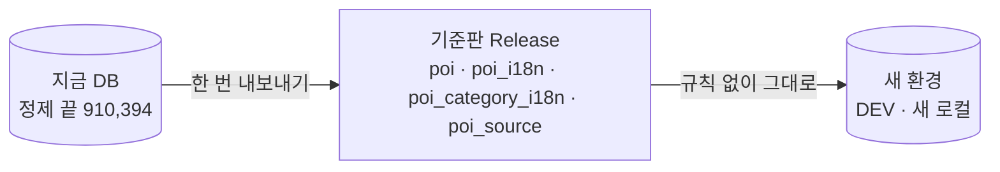

# 편의시설 적재 정리 — 기준판 한 번, 그 뒤로는 DB 기준 출처별 업데이트

- **작성일**: 2026-10-16 (2026-10-17 고침 — 기준판·번호 기록·출처별 흐름으로 다시 씀)
- **티켓**: MZ2AZ-489
- **상태**: 계획
- **앞선 문서**: [poi.md](./poi.md) · [poi-i18n-image.md](./poi-i18n-image.md) §8 · [poi-source.md](./poi-source.md) · [place-poi-link.md](./place-poi-link.md)
  · [ADR 0014](../../architecture/adr/0014-poi-source-is-public-data.md) · [ADR 0022](../../architecture/adr/0022-poi-multiple-source-ids-and-never-delete.md)

---

## 1. 왜

- 적재 규칙이 복잡하다. 대부분 「원본 97 만 줄을 매번 처음부터 정제」 하느라 생겼다(같은 이름·1 m 합치기, 관광공사 100 m 가리기, 남길 줄
  우선순위 넷, TMAP 용 분기).
- 출처 하나만 업데이트하면 틀린다 — 겹침 검사가 이번 입력 안에서만 비교한다(관광공사만 넣으면 중복 핀 약 1.17 만, 상가정보가 빼면 문 닫은
  가게가 관광공사 줄로 되살아남).
- TMAP 잔재가 남아 있다(표본 31 행 중 23 행, `just poi-filter`, 안내문). 2026-09-07 에 출처가 공공데이터로 바뀌었다.

**원칙: 정제는 한 번, 그 뒤로는 DB 가 기준이다. 출처가 명시적으로 알려 준 변경만 반영한다. 지우지 않는다.**

**지금 DB 는 지우지도 다시 적재하지도 않는다.** 편의시설 91 만 곳·관광공사 상세 33,010·사진·영어 칸·리뷰·코스가 그대로 출발점이다 —
편의시설 번호(`poi.id`)가 그대로라 붙은 것이 모두 그대로 이어진다. 바뀌는 것은 표 하나를 더하고, 그 뒤 업데이트가 제자리에서 고치는 것뿐이다.

## 2. 확인한 사실 (2026-10-16~17)

| 사실 | 근거 |
| --- | --- |
| 지금 DB(로컬·PRD 같음)는 2026-06 판 972,952 줄을 `seed/poi.sql` 로 정제한 910,394 곳 | Release manifest · PRD 적재 로그 |
| 관광공사 동기화 목록 `areaBasedSyncList2` — `modifiedtime=YYYYMMDD`(그날 바뀐 것), `showflag` 1 표출 / 0 표출 중단. 목록과 같은 칸(주소·좌표·분류·전화·사진)을 준다. 한 페이지 최대 1,000 | 실측: 2026-10-16 하루 381 건, `showflag=0` 누적 19,575 |
| 관광공사는 번호를 거의 유지한다 | 9/6 목록 대비 6 주: 기존 번호 유지·수정 5,370, 중단 471, 새 번호 303(그중 재발급 의심 최대 16) |
| 소상공인은 같은 가게에 새 번호를 자주 준다(번호에 등록 연월이 들어 있다 — 추정) | 2025-12 → 2026-06: 사라짐 114,365, 새 번호 153,005, 그중 같은 가게로 이어진 것 약 4.6 만(poi-i18n-image.md §8, 파이썬 재현) |
| 소상공인 API 「수정일자기준 조회」(`storeListByDate`)는 **증분이 아니다** — 분기 기준일(20260630)에만 그 판 전체 2,772,473 건, 변경구분은 표본 4,000 건 모두 `C`, 변경일 비어 있음 | 실측(키 `DATA_GO_KR_KEY`) |
| 소상공인 원본에 건물번호(`bldMnno`)·전체 도로명주소가 있는데 변환이 버린다 → 촬영지 연결의 「주소 같음」 이 한 번도 안 걸렸다 | API 응답 · `build_from_public.py:57-58` |
| 소상공인 다음 판: 기준일 2026-09-30, 파일 등록 예정 2026-10-31 | 공공데이터포털 |

## 3. 데이터 — 무엇이 바뀌나

**새 표 하나: 번호 기록(`poi_source`).** 실제 가게 하나 = 편의시설 하나, 출처 번호는 여러 장.

| 칸 | 뜻 |
| --- | --- |
| `poi_id` | 편의시설 |
| `source` | `store`(소상공인) · `tour`(관광공사 국문) · `tour_en`(관광공사 영문 — 상세만 붙는다) · `transit`(교통) |
| `source_id` | 출처 번호(`MA…` · `tour-…` · `tour-en-…` · `air-…` 등). 유일 |
| `active` | 이번 판(관광공사는 마지막 동기화)에 살아 있나. 빠지거나 표출 중단이면 false — 행은 지우지 않는다 |

- 관광공사 영문은 국문과 **번호 체계가 따로다**(받아 둔 목록 국문 49,772 · 영문 15,287, 같은 번호 0). 그래서 영문 번호는 편의시설을 만들지 않고,
  짝지은 결과(제목 괄호 속 한국어 이름 + 300 m, 지금 `poi_detail.sql` 규칙 — 로컬 13,419 곳 짝)를 여기에 기록해 다음부터 번호로 바로 찾는다.
- **상세·사진은 그 관광공사 번호가 살아 있을 때만 내보낸다**(`poi_detail`·`poi_image` 의 관광공사 번호 ↔ `active`). 표출 중단돼도 행은 지우지 않는다 —
  다시 표출되면 그대로 다시 보인다. 서버 조회에 이 조건 하나를 더한다.

- `poi.source_id` 는 대표 번호로 남긴다 — 지금 이 칸을 읽는 코드가 깨지지 않게.
- 첫 채움: 지금 편의시설 910,394 곳의 번호 + 처음 적재 때 합쳐지며 버려진 번호 22,818(`~/SceneTrip-data/SceneTrip_POI/analysis/poi_lineage-2026-06.jsonl`,
  줄마다 「어느 POI 에 합쳐졌나」). 이 22,818 덕분에 관광공사 상세를 1.2 만 곳에 더 붙인다.
- 앱·API 응답은 바뀌지 않는다.
- 변환에서 건물번호·전체 도로명주소를 살린다.

## 4. 처음 적재 — 기준판

- 기준판 = 지금 DB 의 편의시설 표를 그대로 뜬 것. 공공데이터라 공개 Release 로 둔다(ADR 0014).
- 새 환경은 이걸 넣기만 한다. 원본 정제 규칙(같은 이름·1 m, 관광공사 100 m 가리기, 우선순위)은 코드에서 지운다.
- CI 는 기준판에서 뽑은 작은 표본(지금 모슬포처럼 한 bbox 에 숙박·명소가 모인 곳)을 쓴다.

## 5. 업데이트 — 출처별

### 5-1. 공통 두 가지

**같은 가게 판정(하나로 모은다)** — 지금 세 군데(`poi_update.sql` · `poi.sql` §4·§4-1 · `place_poi_link.sql`)에 흩어진 관문을 한 함수로.

1. 거리 — 같은 출처 30 m, 다른 출처 100 m(관광공사 좌표가 덜 정확해서 지금도 100 m)
2. 분류 — 같은 갈래
3. 이름 — 같음 / 한쪽이 다른 쪽에 포함(3 글자 이상) / 유사도 0.8 이상(공백·기호 무시, 자모 편집거리)
4. 주소 — 양쪽에 도로명 + 건물번호가 있고 다르면 다른 가게(건물번호를 살린 뒤 쓴다)
5. 짝이 여럿이면 서로에게 가장 가까운 짝만

**줄 거르기** — 갈래 매핑, 제외 분류(유흥 주점 둘·구내식당·기숙사/고시원), 좌표 범위(북위 33~39·동경 124~132), 필수 칸.

### 5-2. 소상공인 — 분기마다, 판 전체를 DB 와 비교

입력: 분기 파일(또는 API 에 기준일) → 음식·숙박만 → 줄 거르기.

| 경우 | 처리 |
| --- | --- |
| 번호가 기록에 있음 | 그 편의시설 고치기(이름·좌표·분류), `active` |
| 새 번호 · 같은 판정으로 소상공인 편의시설과 같은 가게(30 m) | 번호 재발급 — 그 편의시설에 번호 기록 |
| 새 번호 · 관광공사 편의시설과 같은 가게(100 m) | 그 편의시설에 번호 기록. 이름·좌표는 소상공인 것으로 |
| 새 번호 · 같은 가게 없음 | 새 편의시설 |
| 기록에 있던 소상공인 번호가 새 판에 없음(재발급으로 이어지지도 않음) | `active=false`. **그 편의시설을 숨긴다 — 관광공사 번호가 있어도**(음식·숙박 영업 여부는 소상공인을 믿는다) |

### 5-3. 관광공사 — 동기화 목록, 바뀐 것만 (자주 돌려도 된다)

입력: `areaBasedSyncList2` 를 지난번 받은 다음 날부터 오늘까지 날짜마다, 페이지 끝(`totalCount`)까지 → 우리가 쓰는 종류만(`build_tour.py` 의 분류) → 줄 거르기.
지난번 받은 날은 DB 에 둔다.

| 경우 | 처리 |
| --- | --- |
| `showflag=1` · 번호가 기록에 있음 | 고치기. 소상공인 번호도 있는 편의시설이면 이름·좌표는 그대로(소상공인 것) |
| `showflag=1` · 새 번호 | 같은 가게 판정 → 있으면 번호 기록, 없으면 새 편의시설 |
| `showflag=0` · 관광공사에만 있는 편의시설 | `active=false`, 숨긴다 |
| `showflag=0` · 소상공인 번호도 있는 편의시설 | `active=false` 만. 숨김은 소상공인이 정한다 |

### 5-4. 교통 — 가끔, 파일 전체 비교

소상공인과 같다. 교통 자료가 그 시설의 유일한 출처라 빠지면 숨긴다. 번호가 이름으로 만들어져(`train-<역이름>`) 역 이름이 바뀌면 같은 판정으로 잇는다.

### 5-5. 상세 — 편의시설 업데이트 다음에

편의시설(5-2~5-4)을 먼저 끝내고, 그 결과로 상세를 갱신한다. 상세는 관광공사에만 있다.

| 순서 | 무엇 |
| --- | --- |
| 1 | 국문 동기화(5-3)에서 `showflag=1` 로 바뀐 번호만 국문 상세 기능(`detailCommon2`·`detailIntro2`·`detailInfo2`·`detailImage2`)을 다시 부른다 |
| 2 | 영문 동기화 목록(`EngService2/areaBasedSyncList2`)을 날짜마다 받는다 |
| 3 | 영문 `showflag=1` — 번호 기록에 있으면 그 편의시설, 없으면 짝짓기(괄호 속 한국어 이름 + 300 m, 열린 편의시설) → 짝이 되면 기록하고 영문 상세를 부른다. 짝이 없으면 넘긴다(편의시설을 만들지 않는다) |
| 4 | 영문 `showflag=0` — 그 영문 번호 `active=false`. 영문 상세는 안 나가고 편의시설은 그대로 |
| 5 | 상세·사진은 (편의시설, 언어)마다 제자리에서 고친다 — 지금 `poi_detail.sql` 의 맞추기 규칙 그대로(없으면 넣고, 다르면 고치고, 같으면 둔다) |

- 상세 기능은 번호 하나에 한 번이라 한도의 병목이다(기능마다 키당 하루 약 1,000 회). 하루 바뀌는 수백 곳이면 키 셋으로 충분하다.
- 영문은 「있으면 붙이는 덤」 이다 — 편의시설 전체의 약 1.5 %. 영문 상세가 없으면 화면은 지금처럼 칸마다 요청 언어 → en → ko.
- 번호 기록이 생기면 처음 적재 때 상가정보에 합쳐진 관광공사 줄에도 국문 상세가 붙는다 — 지금 상세는 대표 번호가 `tour-…` 인 편의시설에만
  붙어(`poi_detail.sql` 의 `p.source_id = i.source_id`) 이 줄들의 상세는 버려진다. 합쳐진 줄 11,666 중 국문 상세를 이미 받은 것 6,109(2026-10-17,
  수집 27,996 곳 기준) — 나머지는 수집이 끝나면 붙는다.

### 5-6. 업데이트하는 방법 (사람이 하는 일)

명령은 4 단계에서 만들었다(MZ2AZ-492) — `just poi-convert` · `just poi-tour-sync` · `just poi-update` · `just poi-update-publish`. **4 단계 전에 꼭 업데이트해야 하면** 예전 방식 `just seed-poi --update <영어 칸을 붙인 폴더>`
뿐이고, §2 의 구멍(관광공사만 넣으면 중복 핀, 다른 출처 줄로 되살아남)이 그대로다 — 여섯 파일을 한꺼번에 넣고, 끝나면 `just poi-dedupe --dry-run`
으로 중복을 본다. 소상공인 다음 판(2026-10-31 등록 예정) 전에 4 단계를 끝내는 것이 목표다. 원칙은 **재료를 올리고, 로컬과 똑같은 업데이트 과정을 운영에서 돌린다** — 운영 DB 를 로컬 DB 로
덮지 않는다(편의시설 번호 `poi.id` 가 두 DB 에서 같다는 보장이 없고, 운영에만 있는 리뷰·코스·촬영지 연결이 그 번호를 가리킨다).

| 출처 | 언제 | 사람이 하는 일 | 명령이 하는 일 |
| --- | --- | --- | --- |
| 소상공인 | 분기(다음 판 기준일 2026-09-30, 등록 예정 2026-10-31) | 상가정보 zip 을 받아 `raw/` 에 푼다 → `just poi-convert store <CSV 폴더> <out>` → `just poi-en …`(영어 칸) → `just poi-update store <out-en> --dry-run` 으로 보고 → `just poi-update store <out-en>` | §5-2 → 요약 |
| 관광공사 | 원할 때(매일도 된다) | `just poi-tour-sync <자료 폴더>`(한도에 막히면 같은 명령으로 이어 간다) → `just poi-update tour <묶음> --dry-run` → `just poi-update tour <묶음>` | 국문·영문 동기화 → §5-3 → §5-5(상세) → 요약 |
| 교통 | 가끔 | 새 원본을 `raw/교통/` 에 → `just poi-convert transit …` → `just poi-en …` → `just poi-update transit <out-en>` | §5-4 → 요약 |

요약에는 이어진 곳 · 새로 넣은 곳 · 숨긴 곳 · 다시 보이게 된 곳 · 상세 갱신 수 · 사람이 볼 목록(같은 가게 판정이 애매했던 쌍, 두 출처의 말이 다른 곳)을 싣는다.

**운영(DEV·PRD)에 반영** — 지금 관광공사 상세를 올리는 길(`poi-detail-…` Release → 데이터 적재)과 같다.

- 운영으로: `just poi-update-publish <출처> <묶음> <이름>` → 찍힌 줄을 `MODULE.bazel`·`services/scene-api/BUILD.bazel` 의 `POI_UPDATES` 에 옮기는 PR →
  배포 워크플로 「데이터 적재」. 원격 적재(②-4)는 아직 넣지 않은 묶음만(`data_load` 기록의 `poi_updates`) 이름 순서대로 넣는다.
  표가 비어 있지 않으면 판 전체(`poi-data-<판>`)의 처음 적재는 건너뛴다.
- 재료: 소상공인·교통은 변환·영어 칸을 붙인 새 판, 관광공사는 그 기간의 동기화 목록과 다시 받은 상세. 운영 적재 Job 은 밖으로 나가지 않는다(네트워크
  규칙상 DB 포트만) — 그래서 노트북이 받아 Release 로 올린다.
- 같은 재료를 두 번 넣어도 바뀌는 것이 없다 — 실수로 다시 돌려도 안전하다.

**Release 는 운영에 파일을 실어 나르는 상자다** — 운영 적재 Job 이 밖으로 못 나가서, 파일을 Release 에 올리고 적재 이미지에 넣어 보낸다. 상자 종류는
`manifest.json` 의 이름표로 구분한다.

| 상자 | 이름표 | 올리는 명령 | 쓰는 곳 |
| --- | --- | --- | --- |
| 기준판 | `"kind": "base"` | `just poi-base-publish`(3 단계) | 빈 DB 만 |
| 업데이트 재료 | `"kind": "update"`, `"source": "store" \| "tour" \| "transit"`, 판 또는 기간 | `just poi-update-publish <출처> …`(4 단계) | 데이터가 있는 DB(운영) |
| 관광공사 상세 | 지금 그대로 | `just poi-detail-publish`(있음) | 둘 다 |

운영 적재(`remote-load.sh`)의 판단 — `poi` 표가 비었으면 기준판을 넣고 (있으면) 업데이트 재료를 차례로, 비어 있지 않으면 업데이트 재료만 출처별
규칙으로(기준판이 와도 무시 — 운영 데이터를 덮지 않는다). 빈 DB 에 업데이트 재료만 오면 멈춘다. 넣은 재료의 이름표는 `data_load` 기록에 남긴다.
지금(4 단계 전)은 상자가 `poi-data-<판>` 하나이고 같은 판단(빈 표면 처음 적재, 아니면 `--update`)을 한다.
- 기준판(§4)은 DB 가 빈 새 환경에서만 쓴다. 운영은 이미 데이터가 있어 쓰지 않는다. 운영에서 한 번만 하는 일은 2 단계의 번호 기록 표 만들기·채우기다
  — 운영 DB 자신의 번호로 채운다.

### 5-7. 모든 출처에 같은 것

- **숨긴 편의시설은 자기 번호가 다시 살아날 때만 다시 보인다** — 같은 가게의 다른 출처 번호가 이미 기록에 있으니, 그 줄이 새 편의시설로 되살아나지 않는다.
- **지우지 않는다**(ADR 0022). 숨김은 `closed_at` 하나 — 이유를 나누지 않는다(어차피 지도·검색·상세에 안 나온다).
- 넣지 않은 출처의 번호는 건드리지 않는다.
- 같은 판을 다시 넣으면 아무것도 바뀌지 않는다.

## 6. 지울 것

| 무엇 | 어디 |
| --- | --- |
| 원본 정제 규칙 | `poi.sql` §4 같은 이름·1 m, §4-1 관광공사 가리기, 남길 줄 우선순위 — 기준판으로 대체 |
| 지금 갱신 규칙 | `poi_update.sql` — §5 의 출처별 흐름으로 대체 |
| TMAP 잔재 | `just poi-filter`·`tools/scripts/poi-filter.sh`, `poi.sql` 세부 분류(`biz_lower`) 대체 읽기·「전문음식점」 조건, k8s.just seed-poi 안내문, 「표본 23 행」 문구, iOS `RoutePoiTone.swift:39` 주석 |
| 틀린 예시 | 갱신 예시가 영어 칸 없는 `out/` 을 가리킴(`seed-poi.sh` · k8s.just · seed/README.md) |
| 표본의 TMAP 23 행 | `seed/poi-sample.jsonl` → 기준판 표본 + 출처별 「다음 판」 표본 |

ADR 은 기록이라 고치지 않는다. 이 계획이 ADR 0022 의 「같은 건물 + 유사도 0.8」 새 합치기와 「빠짐 기록」 을 지금 판정·`active` 로 대신하므로, 구현 때 0022 를
보정하는 새 ADR 을 쓴다.

## 7. 시험

시험은 구현을 모르는 새 에이전트가 이 문서 §3·§5 만 보고 쓴다. 로컬 DB 내용에 기대지 않고 시험이 기준판 표본과 「다음 판」 을 직접 넣는다.

| 경우 | 확인 |
| --- | --- |
| 소상공인만 | 번호 재발급 이어짐(리뷰·코스 그대로) · 새 가게 · 빠진 가게 숨김 · 관광공사 번호가 있어도 숨김 · 관광공사 편의시설에 번호 붙음(중복 없음) · 관광공사·교통 그대로 |
| 관광공사만 | 소상공인과 같은 가게면 번호만 붙음(중복 핀 없음) · `showflag=0` 관광공사 단독 숨김 · 소상공인 번호 있으면 안 숨김 · 페이지 1,000 넘는 날 |
| 상세 | 바뀐 번호만 상세 다시 받음 · 표출 중단된 번호의 상세·사진은 안 나가고 행은 남음 · 다시 표출되면 다시 나감 · 영문 짝 기록 뒤 다음엔 번호로 찾음 · 영문이 없는 편의시설은 그대로 |
| 지우지 않음 | 업데이트 전후 `poi`·`poi_detail`·`poi_image`·리뷰·코스 행 수가 줄지 않는다 |
| 교통만 | 역 이름 바뀜 이어짐 · 없어진 역 숨김 |
| 되살아남 없음 | 소상공인이 뺀 가게가 관광공사 줄로 다시 안 보임 |
| 같은 판 다시 | 변화 0 |
| 조회 | `PoiStoreIntegrationTest` — 특정 가게 대신 기준 bbox 의 아무 숙박, 색인 시험은 「표를 통째로 읽지 않는다」 만 |

## 8. 순서

순서는 1 → 2 → 4 → 3 이다(2026-10-17). 4 는 2 의 번호 기록만 있으면 되고 소상공인 다음 판(10/31) 전에 필요하다. 3(기준판)은 빈 DB 를 새로
만들 때만 필요해 기한이 없다.

1. TMAP 잔재 지우기 + 기존 시험을 지금 데이터 표본에 맞추기 — 동작은 그대로
2. 번호 기록 표(마이그레이션) + 첫 채움(910,394 + 22,818 + 영문 짝 13,419) + 상세·사진을 살아 있는 번호만 내보내는 서버 조건 — MZ2AZ-491
   + **이미 남아 있는 중복 정리** — 처음 적재의 「같은 이름·1 m」 는 좌표를 소수 5 자리로 반올림해 같은지 보는 규칙이라 경계에서 갈린다
   (가가와 0.85 m 쌍이 반올림 값이 달라 이 규칙에 안 걸렸다). 로컬 실측(2026-10-17): 이름이 같고 1.5 m 안인데 따로 남은 열린 편의시설
   187 쌍(상가정보끼리 103 · 상가정보↔관광공사 70). §5-1 같은 가게 판정(거리)으로 다시 보고, 같은 가게면 한쪽을 숨기며 리뷰·코스 항목을
   남는 쪽으로 옮기고(`place_poi_link.sql` 의 옮기기 규칙 — 한 사람 한 곳 리뷰 하나, 나머지는 `review_archive`) 숨긴 쪽 번호를 남는 쪽
   번호 기록에 더한다. 애매한 쌍(전화·구체 분류가 둘 다 다름)은 합치지 않고 목록으로 뽑아 사람이 본다. 운영도 같은 정리를 운영 DB 에 돌린다
   - **로컬 결과(2026-10-17)**: 번호 기록 946,631(대표 910,394 · 영문 짝 13,419 · 합쳐진 번호 22,818). 같은 가게 정리 195 곳 숨김
     (이름을 유니코드 정규화 NFKC 뒤 비교 — 정규화 없이 기호를 지우면 「관악산５호점」·「관악산２호점」 처럼 숫자만 다른 가게가 같은 이름이 돼
     210 쌍이 나왔다. 측정 때의 187 은 이름을 그대로 비교한 수). 국문 상세 6,100 곳이 번호 기록으로 새로 붙었다. 편의시설·상세·사진 행 수는
     줄지 않았다
   - **건물번호 살리기는 4 단계로 옮겼다** — 변환 스크립트가 저장소 밖(`~/SceneTrip-data/SceneTrip_POI/tools/`)이고, 건물번호는 새 판과 비교할 때만
     쓴다. 다음 소상공인 판 때 변환을 저장소로 들여오며 함께 한다
3. 기준판 내보내기·Release·새 환경 넣기, 원본 정제 규칙 지우기
4. 출처별 편의시설 업데이트(§5-2~5-4) → 상세 업데이트(§5-5) + 시험
5. 로컬 리허설 — 소상공인 2026-09 판(10/31 이후)·관광공사 동기화·교통을 실제 DB 에. PRD 는 리허설 뒤 배포 워크플로로
6. 문서 정리, ADR 0022 보정 ADR

## 9. 열린 질문

- 관광공사 동기화를 PRD 에서 무엇이 돌리나 — 처음엔 데이터 적재 동작에 붙여 손으로, 나중에 정기 작업(쿠버네티스 CronJob)
- 기준판에 관광공사 상세(`poi_detail`)·사진도 넣을지, 지금처럼 별도 Release(`poi-detail-…`)로 둘지
- 소상공인 API 로 분기 판을 받을지(277 만 건 · 2,773 번 호출) 파일로 받을지 — 하루 호출 한도를 확인한 뒤
