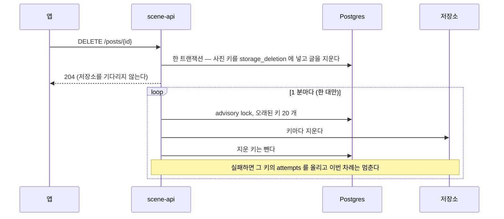

# 후기를 지우면 사진 파일도 지운다 — 지울 목록 표와 1 분 작업 (MZ2AZ-406)

작성자가 커뮤니티 여행후기(`DELETE /posts/{postId}`)를 지우면 DB 행은 사라지지만 저장소(로컬 MinIO, AWS S3)의
`posts/…` 사진 파일은 남았다. `PostStore.delete` 가 DB 만 지우고, `PhotoStorage` 에는 지우는 기능이 없었다.
iOS 업로드 QA(MZ2AZ-396)에서 발견했다. 서버 구현은 [community-post.md](./community-post.md)(MZ2AZ-352).

## 1. 결정 (2026-10-14, 권호)

| 항목 | 결정 | 이유 |
| --- | --- | --- |
| 작성자가 글을 지울 때 | 사진 파일을 **지체 없이** 지운다. 보관 기간을 두지 않는다 | 글·사진을 보관할 법적 의무가 없다(개인정보보호법 제21조 — 목적을 다하면 지체 없이 파기) |
| PRD 버킷의 옛 버전 | 수명 규칙대로 **30 일 뒤 영구 삭제**. 버전까지 지우지 않는다 | PRD 사용자 사진 버킷은 버전 관리가 켜져 있다([ops-protection.md](./ops-protection.md), MZ2AZ-364). 지우면 「삭제 표시」가 얹혀 주소는 바로 404 가 되고, 원본은 이전 버전으로 30 일 남는다. 사고로 지운 사진을 되살리는 길을 남기고 IAM 을 넓히지 않는다. 처리방침에 「30 일 이내 완전 파기」로 적는다(MZ2AZ-418) |
| 탈퇴 | 바꾸지 않는다 — 글·사진은 남고 글쓴이만 끊긴다 | community-post.md §1 그대로 |
| 범위 | 커뮤니티 후기만 | 리뷰 사진(같은 문제, `ReviewStore.delete`)·운영자 내림(`removed_at`)·이미 남은 옛 파일 청소는 이번에 하지 않는다 |

## 2. 왜 지울 목록 표인가

글을 지운 뒤 저장소를 바로 부르기만 하면, DB 는 지워졌는데 저장소 호출이 실패했을 때 **어떤 파일이었는지 기록이
함께 사라져** 다시 지울 길이 없다. 그래서 글을 지우는 트랜잭션 안에서 사진 키를 `storage_deletion` 표에 적고,
저장소에서 지우는 일은 **1 분마다 도는 작업 하나가 전부** 맡는다. 글 삭제와 목록 기록은 함께 되거나 함께 안 된다
(outbox 패턴).

- **지우는 길은 하나다.** 요청은 DB 만 쓰고 바로 204 를 낸다 — 저장소가 느리거나 고장이어도 삭제 요청은 영향이 없다.
  사진 주소는 최대 1 분 뒤 404 가 된다.
- **1 분 cron 으로 돈다(`0 * * * * *`).** 가상 스레드를 켠 이 서버의 스케줄러(`SimpleAsyncTaskScheduler`, Spring 6.1+)는
  cron 실행을 매번 새 가상 스레드에 넘긴다. 고정 지연(`fixedDelay`)은 스케줄러 스레드 하나에서 직접 돌아, 길어지면 다른
  작업(`PopularityJob`·`GuideTurnLog`)의 시작까지 밀린다 — 그래서 쓰지 않는다. 평소엔 목록이 비어 인덱스를 탄 조회 한 번이다.
- **한 번에 20 개, 저장소가 실패하면 그 차례는 멈춘다.** 저장소가 고장인데 남은 키를 다 두드리며 타임아웃을 기다리지
  않는다. 한 번 실행이 길어지지 않는다.
- **한 대만 돈다.** PRD 는 scene-api 가 두 대라 타이머도 두 개지만, 시작할 때 Postgres advisory lock 을 잡지 못한 쪽은
  그 차례를 건너뛴다(`PopularityJob` 과 같은 방식). 두 대가 함께 돌아도 결과는 같다(같은 키를 두 번 지워도 저장소는 성공)
  — 잠금은 실패 횟수를 바로 세고, 버전 관리 버킷에 삭제 표시가 겹쳐 쌓이지 않게 하려는 것이다. 대가로 작업이 도는 동안
  DB 연결 하나를 잡는다(풀 10 개 중).
- 한 파일을 두 글이 함께 쓰는 일은 없다(`community_post_photo.storage_key` UNIQUE). 「공유 중인 파일은 지우지 않는다」는
  조건이 따로 필요 없다.

## 3. 표 (V34)

`storage_deletion` — 지울 저장소 키 하나가 한 줄.

| 칸 | 뜻 |
| --- | --- |
| `storage_key` (PK) | 지울 키. 같은 키가 두 번 들어오지 않는다 — 이미 목록에 있는 키를 다시 올리면 있던 줄을 그대로 두고 넘어간다(`ON CONFLICT DO NOTHING`). 글 삭제는 그것 때문에 실패하지 않는다 |
| `created_at` | 목록에 오른 때 |
| `attempts` | 지우기에 실패한 횟수 |
| `last_error` | 마지막 실패 내용 |

## 4. 코드

| 자리 | 바뀌는 것 |
| --- | --- |
| `PhotoStorage.delete(key)` | 새 기능. S3 는 `DeleteObject`. 저장소가 없는 환경(`NoPhotoStorage`)은 사진이 생길 길이 없으므로 지우기 작업이 돌지 않는다 |
| `PostStore.delete` | 같은 트랜잭션에서 사진 키를 목록에 넣고 글을 지운다 — 목록에 먼저 넣는다(글을 먼저 지우면 CASCADE 로 사진 행이 사라져 키를 모른다) |
| `PostsController.deletePost` | 바뀌지 않는다 — 내 글이 아니거나 없으면 404, 지웠으면 204 |
| 지우기 작업 | `@Scheduled` cron(설정값, 기본 1 분). 한 트랜잭션에서 `pg_try_advisory_xact_lock` 을 잡고, 못 잡으면 건너뛴다. 오래된 것부터 20 개를 지우고, 지운 줄은 뺀다. 실패하면 `attempts`·`last_error` 를 올리고 로그를 남긴 뒤 그 차례를 멈춘다. 저장소가 없는 환경에서는 돌지 않는다 |

IAM 은 그대로다 — scene-api 역할에 `posts/*` 의 `s3:DeleteObject` 가 이미 있다(`platform/terraform/bootstrap/template.json`).

## 5. 검증

1. 테스트 — 명세만 본 새 컨텍스트가 짜고 돌린다: 지우면 목록에 오르고 작업이 파일을 지운다, 저장소가 실패하면 목록에
   남고 다음 차례에 지워진다, 남의 글은 지우지 못하고 목록도 생기지 않는다, 잠금을 다른 쪽이 잡고 있으면 건너뛴다.
2. `just check`.
3. 로컬 실측 — MinIO 에 사진을 올려 글을 쓰고, 지운 뒤 1 분 안에 파일이 없어지는지, 이미 받은 한 시간짜리 사진 주소가
   404 인지, 작업이 어느 스레드에서 도는지(로그).

### 결과 (2026-10-14)

- 테스트 22 개(`StorageDeletionJobIntegrationTest` 11, `PostDeletionListIntegrationTest` 7,
  `PostDeleteFlowIntegrationTest` 4) 통과. `//tools/aws/integration:database_test`(V34 를 AWS DB 역할로 적용) 통과.
  scene-api 통합 테스트의 다른 실패 5 개(`PoiSeedIntegrationTest` 3, `PoiStoreIntegrationTest` 2)는 로컬 DB 에 편의시설
  전량(약 91 만 행)이 들어 있어 표본 행이 없어서다 — 같은 기준 커밋의 CI 통합 잡은 통과.
- 로컬 실측(kind, MinIO): 사진 두 장 글을 지우자 204(0.05 초), 키 두 개가 목록에 올랐고 받아 둔 사진 주소는 아직 200.
  다음 정각 분(22:05:00)에 작업이 「사진 파일 2 개를 지웠습니다」, 목록이 비고 사진 주소는 404. 작업은 `scheduling-3`
  스레드에서 돌았다 — 실행마다 새 스레드다(풀 하나를 쓰면 늘 `scheduling-1`).
