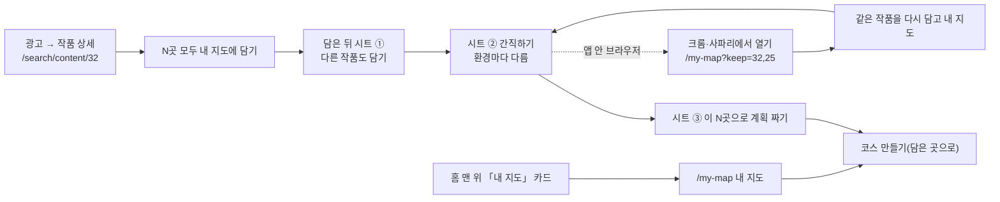

# 웹 — 담기 중심 흐름: 한꺼번에 담기 → 더 담기 → 간직하기 → 계획

- **상태**: 구현·검증 끝(2026-11-14 밤), dev 에 올림. 사용자가 dev.scenetrip.io 에서 확인한 뒤 main. 실기기 확인이 남은 것은 §7.
- **티켓**: [MZ2AZ-570](https://mz2az.atlassian.net/browse/MZ2AZ-570) (PR #486·#487). 편의시설 담기는 [MZ2AZ-571](https://mz2az.atlassian.net/browse/MZ2AZ-571) — [계획](keep-poi.md).
- **근거**: 2026-11-14 김상규 멘토 멘토링(엠지옵시 `00_멘토링 및 회의역사/79_(11.14) 김상규 멘토님`), 같은 날 지표 점검.
  - 광고로 온 사람의 95% 이상이 한 번도 누르지 않고 나간다. 첫 화면이 「어디로 여행 가세요?」 라 여행을 정하지 않은 사람은 답할 수 없다.
  - 멘토: 코스보다 **담기**를 가운데에 둔다. 작품(케이팝 데몬 헌터스)으로 들어온 사람이 장소를 담고 → 더 담고 → 즐겨찾기·홈 화면에 남기고 → 그다음에 계획을 짠다.
  - 광고 방문자의 99.7% 는 페이스북·인스타 **앱 안 브라우저**다(PostHog 11/12~14, 1,300명 중 1,296명). 거기에는 즐겨찾기·홈 화면 추가가 없고, 닫으면 담은 것이 사라진다.

## 1. 흐름



- 코스 만들기는 입구가 아니라 **출구**다. 「어디로·며칠」 은 담은 뒤에 묻는다(기존 「담은 곳으로」 마법사 그대로).
- 멘토 안의 「이걸 확정하시겠습니까?」 확인 단계는 넣지 않는다 — 「모두 담기」 단추가 곧 확정이다(사용자가 원하면 아침에 더한다).
- 식당·쇼핑 담기는 이번 범위 밖이다. 장바구니 API 가 촬영지(`placeId`)만 받는다.

## 2. 규칙 (순수 함수 — `features/keep/keepRules.ts`, 시험은 이 절만 보고 쓴다)

### 2-1. 환경

```ts
export type KeepEnv = 'in_app_android' | 'in_app_ios' | 'installable' | 'android_menu' | 'ios_safari' | 'installed' | 'other'
export function isInAppBrowser(userAgent: string): boolean
export function keepEnv(input: { userAgent: string; standalone: boolean; canPromptInstall: boolean }): KeepEnv
```

- `isInAppBrowser`: UA 에 `FB_IAB`·`FBAN`·`FBAV`·`FBIOS`·`Instagram`·`Line/`·`KAKAOTALK` 중 하나가 있거나, 안드로이드 웹뷰 표식 `; wv)` 가 있으면 참. 대소문자를 가린다(있는 그대로 비교).
- `keepEnv` 는 위에서부터 먼저 맞는 것을 돌려준다.
  1. `standalone` 이 참 → `installed`
  2. 앱 안 브라우저이고 UA 에 `Android` → `in_app_android`
  3. 앱 안 브라우저이고 UA 에 `iPhone`·`iPad`·`iPod` 중 하나 → `in_app_ios`
  4. 앱 안 브라우저(그 밖의 기기) → `other`
  5. `canPromptInstall` 이 참 → `installable`
  6. UA 에 `Android` 가 있다 → `android_menu` (설치 창을 못 띄우는 안드로이드 브라우저 — 메뉴로 안내한다)
  7. UA 에 `iPhone`·`iPad`·`iPod` 중 하나가 있고 `Safari` 가 있으며 `CriOS`·`FxiOS`·`EdgiOS` 가 없다 → `ios_safari`
  8. 그 밖 → `other`

### 2-2. 넘기는 주소

```ts
export function parseKeepParam(search: string): number[]
export function keepUrl(origin: string, contentIds: readonly number[]): string
export function handoffHref(env: KeepEnv, url: string): string | null
```

- `parseKeepParam('?keep=32,25')` → `[32, 25]`. 쉼표로 나눈 것 중 **양의 정수**만 남기고, 같은 값은 처음 것만, 순서는 그대로, 최대 6개. `keep` 이 없거나 비면 `[]`. 다른 쿼리(`utm_*`)가 섞여 있어도 된다.
- `keepUrl('https://app.scenetrip.io', [32, 25])` → `'https://app.scenetrip.io/my-map?keep=32,25'`. id 가 없으면 `'https://app.scenetrip.io/my-map'`. 6개까지만 싣는다.
- `handoffHref(env, url)` — `url` 은 `https://` 로 시작하는 완전한 주소다.
  - `in_app_android` → `intent://<host><path+query>#Intent;scheme=https;S.browser_fallback_url=<encodeURIComponent(url)>;end`
    (예: `https://app.scenetrip.io/my-map?keep=32` → `intent://app.scenetrip.io/my-map?keep=32#Intent;scheme=https;S.browser_fallback_url=https%3A%2F%2Fapp.scenetrip.io%2Fmy-map%3Fkeep%3D32;end`)
    크롬을 지정(`package=`)하지 않는다 — 지정하면 주소가 안 열린다는 보고가 있고, 지정하지 않으면 기본 브라우저가 연다.
  - `in_app_ios` → `x-safari-` + `url` (예: `x-safari-https://app.scenetrip.io/my-map?keep=32`)
  - 그 밖 → `null`

### 2-3. 더 담을 작품 · 내 지도 묶음

```ts
export function moreWorks(works: readonly ContentSummary[], excludeIds: ReadonlySet<number>, limit?: number): ContentSummary[]
export function mapGroups(items: readonly CartItem[]): { contentId: number | null; title: string | null; count: number }[]
export function mapBounds(items: readonly CartItem[]): { minLat: number; minLng: number; maxLat: number; maxLng: number } | null
```

- `moreWorks`: `placeCount > 0` 이고 `delisted` 가 아니며 `excludeIds` 에 없는 작품을 **받은 순서 그대로** 앞에서 `limit`(기본 5)개.
- `mapGroups`: `sourceContentId` 로 묶는다. 묶음 순서는 그 작품이 목록에 처음 나온 순서, 출처가 없는 것(`null`)은 한 묶음으로 맨 뒤. `title` 은 그 묶음 첫 항목의 `sourceContentTitle`(없으면 `null`).
- `mapBounds`: `latitude`·`longitude` 가 둘 다 숫자인 항목만으로 최소·최대를 낸다. 그런 항목이 없으면 `null`.

## 3. 한꺼번에 담기 — `cartActions.addMany` (`state/cart.ts`)

```ts
addMany(placeIds: readonly number[], sourceContentId: number | null, onProgress?: (done: number, total: number) => void): Promise<{ saved: number; already: number; failed: number }>
```

- 받은 순서대로 **하나씩** `POST /cart/items` 를 보낸다(서버에 묶음 담기는 없다).
- 이미 `placeIds` 에 든 장소는 요청하지 않고 `already` 로 센다.
- 201 → `saved`, 스토어의 `placeIds` 에 **즉시** 넣는다(줄이 하나씩 「담음」 으로 바뀌어 보이게).
- 409 `DUPLICATE_CART_ITEM` → `already`, `placeIds` 에 넣는다.
- 그 밖의 실패 → `failed`, 멈추지 않고 다음으로 간다.
- 한 장소가 끝날 때마다 `onProgress(지금까지 끝난 수, 전체 수)` 를 부른다.
- 끝나면 `refresh()` 를 **한 번** 부르고, 알림은 한 번만 띄운다.
  - `failed === 0` → `say('N곳을 내 지도에 담았어요', 'Saved N spots to your map')` (N = saved + already)
  - `failed > 0` → `say('N곳은 담지 못했어요. 다시 눌러 주세요', "Couldn't save N spots. Tap again.")` (N = failed)
- 분석: 끝에 `webEvent.saveAll(contentId ?? 0, 전체 수, saved)` 한 번. 장소마다 `save_place` 는 보내지 않는다.
- 도중에 계정이 바뀌면(`accountGeneration`) 스토어를 건드리지 않고 그때까지의 수를 돌려준다.

## 4. 분석 이벤트 (`analytics/events.ts` 의 `webEvent`, 이름은 소문자·밑줄)

| 이벤트 | 함수 | 매개변수 |
| --- | --- | --- |
| `save_all` | `webEvent.saveAll(contentId, placeCount, savedCount)` | `content_id`, `place_count`, `saved_count` |
| `keep_more` | `webEvent.keepMore(contentId)` | `content_id` — 「다른 작품도 담기」 에서 고른 작품 |
| `keep_prompt` | `webEvent.keepPrompt(env, action)` | `env` = §2-1 의 값, `action` = `view` · `open_browser` · `install` · `install_accepted` · `install_dismissed` · `sign_in` · `got_it` · `skip` |
| `keep_arrive` | `webEvent.keepArrive(count)` | `count` — `?keep=` 로 넘어와 다시 담은 작품 수 |
| `my_map` | `webEvent.myMap(action)` | `action` = `open_home`(홈 카드) · `open_keep`(시트) · `open_detail`(작품 상세 「내 지도 보기」) · `open_place` · `plan` · `add_more` |

- `plan_start` 의 `entry` 에 `my_map` · `keep_sheet` 를 더한다.
- `sign_in_prompt` 의 `reason` 에 `keep` 을 더한다.

## 5. 화면

문구는 `say(한국어, 영어)`. 색·모서리·단추는 새 홈(`features/proto/protoTokens.ts`·`protoParts.tsx`)의 것을 쓴다.

### 5-1. 작품 상세의 「모두 담기」 — `features/keep/SaveAllBar.tsx`

```ts
export function SaveAllBar(props: {
  total: number                 // 이 작품 촬영지 수(목록에 실제로 받은 수)
  savedCount: number            // 그중 이미 담은 수
  progress: { done: number; total: number } | null   // 담는 중이면 값
  onSaveAll: () => void
  onOpenMap: () => void
}): JSX.Element | null
```

| 상태 | 보이는 것 |
| --- | --- |
| `total === 0` | 아무것도 그리지 않는다(`null`) |
| 담는 중(`progress !== null`) | 눌리지 않는 단추 `say('담는 중… 3/10', 'Saving… 3/10')` |
| `savedCount === 0` | 채운 주 단추 `say('10곳 모두 내 지도에 담기', 'Save all 10 spots to my map')` → `onSaveAll` |
| `0 < savedCount < total` | 채운 주 단추 `say('남은 4곳도 담기', 'Save the other 4 spots')` → `onSaveAll` |
| `savedCount === total` | 옅은 단추 `say('10곳 모두 담음 · 내 지도 보기', 'All 10 saved · See my map')` → `onOpenMap` |

- 자리: `ContentDetail` 의 「촬영지 N곳」 머리줄 바로 아래, 목록 위. 목록에서 빠진 작품(`delisted`)이면 그리지 않는다.
- 누르면 `addMany(담지 않은 장소들, 작품 id)`. 끝나고 `saved + already > 0` 이면 담은 뒤 시트(§5-2)를 연다.

### 5-2. 담은 뒤 시트 — `features/keep/KeepSheet.tsx`, 상태는 `features/keep/keepStore.ts`

```ts
export type KeepStep = 'more' | 'keep' | 'plan'
export const keepStore: Store<{ open: boolean; step: KeepStep; contentIds: number[]; title: string | null }>
export const keepActions: { openAfterSave(contentId: number, title: string): void; openAt(step: KeepStep, contentIds: number[]): void; go(step: KeepStep): void; close(): void }
```

- `contentIds` 는 이번에 담은 작품들이다(넘기는 주소에 싣는다). 「다른 작품도 담기」 에서 고르면 뒤에 붙는다.
- **① more** — 「✓ {작품} {N}곳을 내 지도에 담았어요」 + 「다른 작품도 담아 볼까요?」 포스터 최대 5개(`moreWorks(홈의 지금 뜨는 작품, 이번에 담은 작품들)`).
  포스터를 누르면 그 작품 촬영지(`GET /contents/{id}/places`)를 `addMany` 로 담고 포스터에 「✓ N곳」. 주 단추 `say('다 담았어요', "I'm done")` → ②.
- **② keep** — 환경(§2-1)마다 한 가지를 권한다. 화면이 뜨면 `keep_prompt(env,'view')`.

  | env | 제목 | 주 단추 | 누르면 |
  | --- | --- | --- | --- |
  | `in_app_android` | `say('브라우저에서 열어 내 지도를 간직하세요', 'Open in your browser to keep your map')` | `say('브라우저에서 열기', 'Open in browser')` | `handoffHref` 로 이동, `open_browser`. 1.5초 뒤에도 화면이 보이면 안내 문구(§8)를 보인다 |
  | `in_app_ios` | `say('사파리에서 열어 내 지도를 간직하세요', 'Open in Safari to keep your map')` | `say('사파리에서 열기', 'Open in Safari')` | 위와 같다 |
  | `installable` | `say('홈 화면에 SceneTrip 을 추가하세요', 'Add SceneTrip to your Home Screen')` | `say('홈 화면에 추가', 'Add to Home Screen')` | 브라우저 설치 창(`install`), 결과 `install_accepted`·`install_dismissed`, 그다음 ③ |
  | `android_menu` | 같은 제목 | `say('알겠어요', 'Got it')` | 「오른쪽 위 ⋮ → 홈 화면에 추가」 안내를 보여 주고, 누르면 `got_it` → ③ |
  | `ios_safari` | 같은 제목 | `say('알겠어요', 'Got it')` | 「공유 → 홈 화면에 추가」 두 줄 안내를 보여 주고, 누르면 `got_it` → ③ |
  | `other` | `say('이 페이지를 즐겨찾기에 추가하세요', 'Bookmark this page')` | `say('알겠어요', 'Got it')` | `got_it` → ③ |
  | `installed` | (이 단계를 건너뛰고 바로 ③) | | |

  - 앱 안 브라우저 두 경우에는 본문에 「이 창을 닫으면 담은 곳이 사라져요」 를 적는다.
  - 가입하지 않았고 앱 안 브라우저가 **아니면** 보조 단추 `say('로그인해서 어디서나 보기', 'Sign in to see it anywhere')` → 로그인 창(이유 `keep`), `sign_in`.
  - 모든 경우에 「나중에」(`skip`) → ③.
- **③ plan** — `say('이 N곳으로 여행 계획을 짜 볼까요?', 'Plan a trip with these N spots?')`. 주 단추 `say('계획 짜기', 'Plan my trip')` → 시트를 닫고 「담은 곳으로」 마법사(§5-5), `plan_start('keep_sheet')`. 보조 `say('내 지도 보기', 'See my map')` → `/my-map`(`my_map('open_keep')`). 닫기.

### 5-3. 내 지도 — 덮개 `/my-map` (`features/keep/MyMapCover.tsx`)

- 머리줄 「내 지도 · N곳」 과 뒤로. 위 절반은 지도(담은 곳 핀, 전부 보이게 맞춤), 아래는 작품별 묶음(`mapGroups`) 목록 — 줄마다 사진·이름·주소. 줄이나 핀을 누르면 그 촬영지 상세(`my_map('open_place')`).
- 아래 고정 주 단추 `say('이 N곳으로 계획 짜기', 'Plan a trip with these N spots')` → §5-5, `my_map('plan')` + `plan_start('my_map')`. 보조 「더 담기」 → 지금 뜨는 작품 전체(`/trending`), `my_map('add_more')`.
- 받는 중: 가운데 돌아가는 표시. 비었음: 「아직 담은 곳이 없어요」 + 「작품 둘러보기」(→ `/trending`). 실패: 「못 불러왔어요」 + 다시 시도.
- 좌표 없는 항목은 목록에만 보인다.

### 5-4. 넘어온 사람 — `?keep=`

- 앱이 뜰 때 주소에 `keep` 이 있으면: 작품마다 촬영지를 받아 `addMany` 로 담고(이미 담긴 것은 그대로), 주소에서 `keep` 을 지우고 `/my-map` 을 연다. `keep_arrive(작품 수)`.
- 앱 안 브라우저가 아니면 담은 뒤 시트를 ② 에서 연다(이제 홈 화면 추가를 권할 수 있다). 앱 안 브라우저면 시트를 열지 않는다(같은 권유가 돌지 않게).

### 5-5. 계획으로 — 「담은 곳으로」

- `pendingStore` 에 `plannerManual: boolean` 을 더한다. 경로여정 덮개(`RouteCover`)가 열릴 때 이 쪽지가 있으면 직접 짜기 마법사(`manual`)를 띄운다(기존 `planner` 쪽지가 AI 마법사를 띄우는 것과 같은 방식).

### 5-6. 홈

- **내 지도 카드**(`features/keep/MyMapCard.tsx`): 담은 곳이 1곳 이상이면 인사 머리줄 바로 아래, 「어디로 여행 가세요?」 카드 **위**에 둔다. 제목 「내 지도」, 「N곳」, 작품별 수 칩(`mapGroups`, 최대 3개 + 「+N」), 사진 가로줄(최대 6장), 주 단추 `say('지도에서 보기', 'See on map')` → `/my-map`(`my_map('open_home')`), 보조 `say('계획 짜기', 'Plan my trip')` → §5-5(`plan_start('my_map')`). 담은 곳이 없으면 그리지 않는다.

  ```ts
  export function MyMapCard(props: { items: readonly CartItem[]; onOpenMap: () => void; onPlan: () => void }): JSX.Element | null
  ```

- **앱 이름**: 홈 인사 머리줄의 작은 윗줄 「해태가 기다렸어요」 를 **`SceneTrip`** 글자(강조색, 굵게)로 바꾼다. 아래 큰 줄은 그대로. 한국어·영어 모두 `SceneTrip`.

## 6. 상태

| 화면 | 받는 중 | 비었음 | 실패 | 됨 |
| --- | --- | --- | --- | --- |
| 모두 담기 | 「담는 중… 3/10」, 줄이 하나씩 담음으로 | 촬영지 0곳이면 단추 없음 | 알림 「N곳은 담지 못했어요」, 단추는 「남은 N곳도 담기」 | 「모두 담음 · 내 지도 보기」 + 시트 ① |
| 시트 ① | 고른 포스터에 돌아가는 표시 | 더 담을 작품이 없으면 포스터 줄을 빼고 주 단추만 | 포스터 아래 「담지 못했어요」, 다시 누를 수 있다 | 포스터에 「✓ N곳」 |
| 시트 ② | — | — | 「브라우저에서 열기」 가 안 되면 1.5초 뒤 안내 문구 | 다음 단계 |
| 내 지도 | 돌아가는 표시 | 「아직 담은 곳이 없어요」 | 「못 불러왔어요」 + 다시 시도 | 지도 + 목록 |

## 7. 하지 않는 것 · 남는 것

- 서버·계약은 바꾸지 않는다. iOS·Android 에는 넣지 않는다.
- 서비스 워커는 넣지 않는다. 크롬은 108 부터 메뉴 설치에 서비스 워커를 요구하지 않지만, 단추로 띄우는 설치 창(`beforeinstallprompt`)이 서비스 워커 없이 오는지는 확인하지 못했다. 오지 않으면 `android_menu` 안내(메뉴 → 홈 화면에 추가)가 뜬다 — 실기기 확인이 남는다.
- 실기기 확인이 남는 것: 페이스북·인스타 앱 안 브라우저에서 「브라우저에서 열기」(`intent://`)·「사파리에서 열기」(`x-safari-https://`)가 실제로 넘어가는지, 구글 로그인이 앱 안 브라우저에서 막히는지.
- AI 코스가 터널·병원 같은 곳을 고르지 않게 하는 일(멘토 지적)은 서버·에이전트 쪽이라 따로 한다.
- 식당·쇼핑 담기, 방문 진행 표시(0/10), 같이 담은 작품 추천은 다음.

## 8. 세부 (시험을 쓴 뒤 정한 것)

- `parseKeepParam`: `URLSearchParams` 로 읽는다(`%2C` 도 쉼표다). 조각마다 앞뒤 공백을 떼고 `^\d+$` 인 것만 숫자로 바꾼다(`007` → 7), 0 은 버린다. 중복을 지운 **뒤** 앞에서 6개.
- `addMany`:
  - 입력의 중복 id 는 처음 것만 남긴다. `onProgress` 의 전체 수와 `save_all` 의 `place_count` 는 그 중복을 지운 입력 수다(이미 담긴 장소도 포함). 이미 담긴 장소도 끝난 것으로 쳐 `onProgress` 를 부른다.
  - 알림은 기존 `add` 처럼 `cartStore` 의 `toast` 다.
  - 도중에 계정이 바뀌면 다음 요청을 보내지 않는다. 그때 돌아온 응답은 세지 않고, 알림·`save_all`·`refresh` 도 없다.
- `SaveAllBar`: 담는 중 단추는 `disabled` 다.
- `MyMapCard`: 수는 `say('N곳', 'N spots')`. 칩은 「작품 제목 N」(출처 없는 묶음은 `say('그 밖', 'Other')`), 「+N」 의 N 은 칩으로 못 보인 **묶음 수**다. 사진은 `img`(`imageThumbnailUrl` 이 있으면 그것, 없으면 `imageUrl`, 둘 다 없으면 그 칸은 건너뛴다). 이벤트는 카드가 아니라 부모(홈)가 보낸다.
- `keepStore`: 처음 값 `{ open: false, step: 'more', contentIds: [], title: null }`. `openAt` 은 `title` 을 `null` 로 둔다. `keepActions.addContent(contentId)` 가 `contentIds` 뒤에 붙인다(이미 있으면 그대로).
- 화면 이름: `/my-map` 의 `screen_view` 는 `my_map`.
- 시트 ② 의 「안 열릴 때」 안내 문구: `say('안 열리면 오른쪽 위 ⋯ 를 눌러 「외부 브라우저에서 열기」 를 고르세요', "Didn't open? Tap ⋯ at the top right, then “Open in external browser”.")`.

## 9. 검증 뒤 바꾼 것 (2026-11-14 밤, 독립 검증 지적 — 위 절과 다르면 이 절이 이긴다)

1. **「모두 담기」 자리**: 「촬영지 N곳」 머리줄 아래가 아니라 **작품 제목 머리줄 바로 아래, 포스터 위**. 광고로 들어온 첫 화면(시트 중간 단, 402×874)에서 단추 전체가 탭바에 가리지 않고 보여야 한다.
2. **담은 뒤 시트를 여는 조건**: `failed === 0` 이고 `saved + already > 0` 일 때만. 실패가 있으면 시트를 열지 않는다 — 알림 「N곳은 담지 못했어요」 가 보이고 단추는 「남은 N곳도 담기」 로 남는다.
3. **`save_all` 에 출처**: `webEvent.saveAll(contentId, placeCount, savedCount, source)` — 매개변수 `source` = `detail`(작품 상세의 모두 담기) · `more`(시트 ① 의 포스터) · `arrive`(`?keep=` 로 넘어옴). `addMany(placeIds, sourceContentId, onProgress?, source = 'detail')` 가 그 값을 실어 보낸다.
4. **넘어오는 중**: `keepStore` 에 `arriving: boolean`(처음 값 `false`)을 더한다. `KeepArrival` 이 담는 동안 `true`, 끝나면 `false`. 내 지도는 `arriving` 인 동안 빈 화면 대신 받는 중 표시를 보인다.
   - 넘어온 작품 중 **한 편도 못 담았으면** 시트를 열지 않는다. 시트에 넘기는 `contentIds` 는 담긴 작품만이다.
5. **계획으로 갈 때 미리 고르기**: 「이 N곳으로 계획 짜기」·「계획 짜기」 로 연 직접 짜기 마법사는 담은 곳이 **전부 골라진 채로** 시작한다(경로여정에서 평소처럼 연 마법사는 지금처럼 빈 채로).
6. **홈의 코치 안내**: 홈의 「첫 여행 계획을 짜 보세요」 코치 안내(`home-plan-trip`)는 없앴다(2026-11-14 사용자 결정) — 처음 온 사람의 홈을 가리고 담기 중심 방향과 어긋난다. 담은 곳이 있든 없든 띄우지 않는다(시험 `features/proto/TripFloatBar.test.tsx`). 다른 코치 안내(`fork-options`·`editor-first` 등)는 그대로다.
7. **영어 단수**: 수가 1이면 `1 spot`(복수 `N spots`). 한국어는 그대로 `1곳`. 이 흐름의 모든 문구에 적용한다.
8. **시트 모양**: 손잡이는 가운데. 시트 높이는 내용에 맞춘다(아래에 빈 바닥을 남기지 않는다).
9. **내 지도에서 연 촬영지 상세의 「뒤로」** 는 내 지도로 돌아온다(작품 격자 → 작품 상세의 `returnTo` 와 같은 방식). 기존 상세 동작을 건드려야 해서 위험하면 하지 않고 보고에 적는다.

## 10. 구현하며 더한 것 (명세에 없던 이음매)

- `SaveAllBarPlaceholder` — 촬영지를 받는 동안 「모두 담기」 자리를 같은 높이로 잡아 둔다(포스터가 아래로 튀지 않게). `SaveAllBar` 의 선택 prop `padX`.
- `saveAllProgress`(`keepStore.ts`) — 담는 중 진행 상태. 화면을 나갔다 돌아와도 남고, 담는 중에는 어느 작품의 「모두 담기」 도 다시 시작하지 않는다.
- `spots(n)`(`shared/spots.ts`) — 영어 단수·복수.
- `openPlace(place, { returnTo })` 와 `placeBack` 의 선택 인자 — 내 지도에서 연 촬영지 상세의 「뒤로」.
- 계획으로 갈 때 미리 고르기는 새 홈의 「담은 곳으로」 마법사(`ProtoSavedPlan`)에만 적용된다.
- `keep_arrive` 의 `count` 는 한 곳이라도 담긴 작품 수다.
