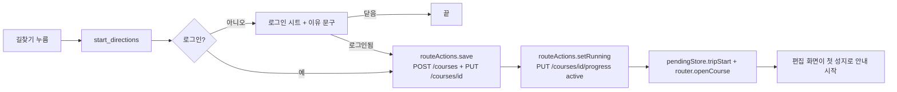

# 웹 촬영지 상세 「길찾기」 — 한 곳짜리 코스를 만들어 바로 안내 (MZ2AZ-532)

- **티켓**: [MZ2AZ-532](https://mz2az.atlassian.net/browse/MZ2AZ-532) — 웹(`apps/scenetrip-web`) DEV 실험
- **작성일**: 2026-11-07
- **상태**: 웹 구현·단위 시험. iOS·Android·서버·계약은 바꾸지 않는다

## 1. 왜

촬영지 한 곳만 가 보고 싶은 사람에게 「코스 만들기」는 병목이다. 장바구니 → 코스 → 저장 → 시작 → 길찾기를 거쳐야 안내가 켜진다.
촬영지 상세에서 한 번 누르면 바로 앱 안 길안내가 켜지게 한다.

## 2. 요구 (사용자, 2026-11-07)

| 항목 | 내용 |
| --- | --- |
| 버튼 | 「길찾기」가 큰 주 버튼(꽉 찬 폭). 「장바구니에 담기」는 테두리형 보조 버튼, 「네이버 지도」 링크는 그대로 |
| 로그인함 | 그 장소 하나로 된 1일·1곳 코스(「{장소} 가는 길」 / "Trip to {장소}")를 만들고 곧바로 여행 모드를 연다 |
| 비회원 | 로그인 시트를 「로그인하면 바로 길안내를 시작해요」 문구로 연다. 로그인되면 같은 장소로 이어서 진행, 닫으면 아무 일도 없다 |
| 오류 | 만들기·시작 실패는 버튼 아래 한 줄(코스 저장 실패와 같은 문구). 길찾기 한도(429)는 여행 모드가 이미 다룬다 |
| 중복 | 두 번 눌러도 코스는 하나 |
| 분석 | `start_directions` — `source=place_detail`, `signed_in`(1·0). 기존 `view_place` 는 그대로 |
| 다국어 | 한국어 원문 + 영어 |

## 3. 구현 경로

서버·계약 변경 없음. 이미 있는 길만 잇는다.

- **코스 만들기**: `routeActions.save(makeCourse(...))` — 「직접 짜기」 저장과 같은 길(`origin: self`, `create_course` 도 그대로 남는다).
- **시작**: 서버는 `active` 코스에만 길찾기를 준다(`COURSE_NOT_ACTIVE` 409). 편집 화면의 「코스 시작」처럼 `setRunning(course, true, 1)` 을 **기다린 뒤** 연다.
- **여행 모드 열기**: 홈 「이어서 길찾기」와 같은 길 — `pendingStore.tripStart = true` 후 `router.openCourse(id)`. 편집 화면(`tripExtensions`)이 첫 미방문 성지로 `startTripTo` 를 부른다.
- **로그인 시트**: 기존 `SignInSheet` 를 그대로 쓰고 `accountActions.openSignIn(이유)` 로 설명 줄만 바꾼다. 계정 상태를 지켜보다 `signedIn` 이 되면 이어서, 로그인 없이 시트가 내려가면 취소.
- **중복 방지**: 컨트롤러(`features/route/placeDirections.ts`)가 진행 중이면 새 누름을 버린다. 만들기는 됐는데 시작이 실패했으면 다시 누를 때 **새로 만들지 않고** 시작만 다시 한다.
- **화면을 떠나면**: 컨트롤러를 버린다 — 시트가 열린 채 다른 장소로 가서 로그인해도 예전 장소로 코스를 만들지 않는다. 만들기·확인 요청 중에 떠났으면 시작(`progress` PUT)으로 가지 않는다 — 만든 코스는 예정(upcoming)으로 남고 다음 누름이 그것을 쓴다.
- **제목 50자**: 계약 `CourseCreate`·`CourseReplace` 의 `title` 은 50자까지다. 영어 "Trip to {긴 이름}" 이 넘으면 장소 이름을 말줄임(…)으로 잘라 50자 안에 둔다. POST·PUT 이 같은 값을 쓴다.
- **다시 쓰기**: 먼저 이 기능이 만든 코스(모듈 단위 기억 `placeId → courseId`, 상세를 다시 열어도 남는다), 그다음 받아 둔 코스 목록의 여행 중·1일·1곳·같은 제목 코스를 후보로, 속을 읽어(`GET /courses/{id}`) 정말 이 장소 하나뿐이면 새로 만들지 않고 연다. 여행 중이면 시작도 다시 하지 않는다.
- **영어**: 영어 문구표는 iOS `Localizable.strings` 에서 생성된다. iOS 에 없는 웹 전용 문구는 `src/i18n/en.web.ts` 에 둔다(생성표가 먼저).

## 4. 시험

`src/features/route/placeDirections.test.ts`(컨트롤러, 가짜 의존성)와 `src/features/search/ui/PlaceDetail.test.tsx`(버튼 배치·비회원 누름).

- 로그인함 → 1일 1곳 코스(장소 id·제목) 만들기 → 시작 → 그 코스로 여행 열기
- 두 번 누름 → 만들기 한 번
- 비회원 → 로그인 시트, 만들지 않음 / 로그인 성공 → 만들기·시작 / 닫음 → 아무것도 / 이벤트 매개변수

## 5. 남은 것

- 로그인한 흐름의 실기 확인(DEV 에 코스가 하나 생긴다) — 사용자가 직접
- iOS·Android 에 같은 버튼을 둘지는 실험 결과를 보고 정한다
