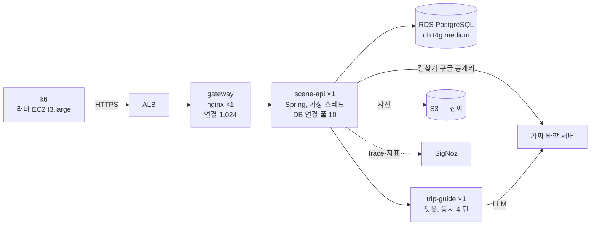

# 부하 테스트 기록

DEV 부하 테스트(MZ2AZ-502, 계획 [load-test.md](../../project/plans/load-test.md))의 실험 기록. 포트폴리오에 그대로 쓸 수 있게 **실험 하나 = 파일 하나**,
아래 양식으로 남긴다. 수치는 그때그때 적고 나중에 고치지 않는다(틀렸으면 아래에 「정정」 을 덧붙인다).

## 결론 세 줄 (2026-10-19 기준)
1. **scene-api 1 대는 초당 약 560~600 요청에서 막힌다.** DB 연결 풀(10 개)이 차고 DB CPU 도 90% 안팎 — 요청은 거절되지 않고 줄을 서서 느려진다(실험 02·07).
2. **줄이 길어지면 앞단 gateway(nginx, 동시 연결 1,024)가 먼저 넘쳐 ALB 가 502·503 을 낸다.** 사용자가 보는 실패의 대부분이 이것이다(실험 03, 02 정정).
3. **그 아래 부하에서는 30 분 동안 지연·메모리가 그대로다**(실험 04·09). 챗봇 서버(trip-guide)는 동시 4 턴·대화 128 개 한도로 평소 부하에서도 실패한다 — 챗봇 서버 티켓(무상태화 MZ2AZ-497, 한도 MZ2AZ-501)으로 넘겼다.

해결 단계에서 다룰 두 사례: **A. 쿼리 줄이기**(지도 영역 조회·촬영지 상세의 DB 일 — 연결을 쥐는 시간을 줄여 같은 풀로 상한을 올린다), **B. 연결 풀 →
gateway 연쇄**(풀 크기·대기 상한·gateway 한도).

## 읽는 법 — 용어·시스템 구성(DEV)

### 시험한 시스템 — DEV, 모두 1 대

PRD 는 gateway·scene-api 가 2 대씩이다(DB 는 같은 크기 하나). 여기 숫자는 **1 대 기준**이라 PRD 로 옮길 때 이 차이를 적는다.

### 수치는 어디서 쟀나 — 같은 「p95」 도 다르다
| 출처 | 무엇을 잰 값 | 기록에서 |
| --- | --- | --- |
| **k6**(러너) | 사용자 쪽 왕복 시간 — ALB·gateway·네트워크·실패한 요청까지 | 「k6: … p95 1.67 초」, 실패율 |
| **SigNoz**(scene-api 안) | 서버가 요청을 받은 뒤 답할 때까지 — gateway 앞 대기·ALB 가 거절한 요청은 없다 | 분 단위 표, 「API 별 응답 시간」 표, DB 시간·연결 풀 |
| **ALB**(CloudWatch) | 실제로 오간 요청 수, ALB 가 낸 5xx | 「ALB 5xx」, 처리량 확인 |
| **쿠버네티스 이벤트** | 상태 점검 실패·재시작(한 시간 뒤 사라진다) | 실험 07·08 |

- **처리량은 ALB 가 기준이다.** SigNoz 는 바쁠 때 trace 를 잃을 수 있다(실험 07 정정 — 그 시험의 13:28~13:35 만). 다른 시험은 ALB 와 맞춰 확인했다.
- **「초당 요청」** 이 두 가지다: k6 의 값은 시험 전체 평균(예: 399), SigNoz·ALB 분 단위 표의 값은 그 분의 값(예: 가장 바쁜 분 560).
- **실패율**: k6 의 `http_req_failed` = 응답이 4xx·5xx 거나 없는 요청 ÷ 전체 요청. 흐름별 실패율은 그 흐름의 요청만으로 센다.
- **시각**: 표는 **UTC**(SigNoz·k6 기본). 문서 머리의 시각에는 KST 를 같이 적었다(KST = UTC + 9). CloudWatch 를 그대로 옮긴 곳은 KST 라고 적었다.
- **「막혔다」**: 처리량이 더 늘지 않고 p95 가 수백 ms 이상으로 뛰기 시작한 때(대개 DB 연결 대기가 0 에서 오르기 시작한 때와 같다).
- **p50·p95·p99**: 요청을 빠른 순으로 늘어놓았을 때 50%·95%·99% 째 값. p95 가 2 초면 20 건 중 1 건은 2 초보다 느리다.
- **DB 연결 풀**: scene-api 가 DB 와 미리 열어 둔 연결 10 개. 쿼리마다 하나를 빌렸다 돌려준다. 다 빌려 가면 다음 쿼리는 줄을 선다(「연결 대기, pending」).
- **상태 점검(probe)**: 쿠버네티스가 몇 초마다 서버에 「살아 있나(생존)」·「받을 수 있나(준비)」 를 묻는 것. 생존에 연달아 실패하면 재시작, 준비에 실패하면 요청을 안 보낸다.
- 시나리오(흐름·비중·프로필)와 그 말(흐름·VU·FLOWS)은 [scenario.md](scenario.md).

### 실험 지도
| 종류 | 무엇을 보나 | v1 | v2 |
| --- | --- | --- | --- |
| 기준(baseline) | 평소 부하(초당 10 흐름 10 분)에서 합격선 | 01 | 06 |
| 한계(stress) | 계단식으로 올려 어디서 무너지나(약 21 분) | 02 | 07 |
| 급증(spike) | 10 초 만에 20 배로 몰렸다 빠질 때 | 03 | 08 |
| 오래 버티기(soak) | 초당 20 흐름 30 분 — 누수 | 04 | 09 |
| 연기 확인(smoke) | 1 분, 도는지만 | — | 05(여기서 네이버 문제를 찾았다) |

v2 는 v1 에 글쓰기·편의시설 상세·후기 읽기·토큰 갱신을 더하고, 앞 단계가 실패하면 흐름을 멈추게 고친 판이다. 같은 종류끼리(02 와 07 등) 견준다.

## 실험 목록

| 날짜 | 실험 | 한 줄 결과 |
| --- | --- | --- |
| 2026-10-19 | [10 사례 A — 지도 POI 조회](2026-10-19-10-사례A-지도POI조회.md) | 편의시설이 적은 화면에서 지도 조회가 전국을 훑던 함정(1%가 DB 일의 23%) → 네모 인덱스로 가까운 순. 막히는 지점 초당 약 497 → 667(+34%), 1초 넘은 조회 288 → 0 |
| 2026-10-18 | [09 v2 오래 버티기](2026-10-18-09-v2오래버티기.md) | 32 분 안정(글쓰기 포함). 토큰 만료 시각 401 121 건 미해결, 후기 404 는 시험 데이터 부딪힘 |
| 2026-10-18 | [08 v2 급증 — 챗봇 재시작](2026-10-18-08-v2급증-챗봇재시작.md) | scene-api 15 초 회복, 챗봇 서버는 생존 점검 실패로 강제 재시작 4 회(대화 유실) |
| 2026-10-18 | [07 v2 한계 — 상태 점검](2026-10-18-07-v2한계-상태점검.md) | 최대 처리량은 v1 과 비슷(초당 약 600), ALB 5xx 는 한 단계 일찍 시작. 상태 점검 실패 발생. **정정**: 「처리량 급락」 은 SigNoz 의 trace 손실이었다 |
| 2026-10-18 | [06 v2 기준](2026-10-18-06-v2기준.md) | 새 흐름 넣어도 평소 부하 넉넉(둘러보기 p95 16ms), 챗봇만 같은 이유로 실패 |
| 2026-10-18 | [05 편의시설 상세 — 네이버](2026-10-18-05-편의시설상세-네이버.md) | v2 연기 확인에서 편의시설 상세가 1 명에도 0.7 초 — 네이버 링크 찾기가 매번 시간 초과(DEV). 시험이 네이버를 가짜로 안 바꾼 빈틈도 |
| 2026-10-18 | [04 오래 버티기](2026-10-18-04-오래버티기.md) | 초당 약 100 요청 32 분 — 지연·힙 그대로(누수 없음). 끝의 401 은 시나리오가 토큰을 갱신하지 않은 탓(v2 에서) |
| 2026-10-18 | [03 급증 — gateway 연결](2026-10-18-03-급증-gateway연결.md) | scene-api 는 15 초 만에 회복, 그러나 gateway nginx 연결 1,024 가 차 ALB 5xx 15,518 — 실험 02 의 실패도 대부분 이것(정정) |
| 2026-10-18 | [02 한계 — DB 연결 풀](2026-10-18-02-한계-DB연결풀.md) | scene-api 1 대가 초당 약 560 요청에서 막힘 — 연결 풀 10 개 앞에 500 요청 대기(500 은 gateway 한도), DB CPU 94%, DB 시간 22% 는 지도 영역 조회 |
| 2026-10-18 | [01 기준 — 챗봇 한도](2026-10-18-01-기준-챗봇-한도.md) | 초당 10 명 기준에서 챗봇 81.6% 실패 — 동시 처리 4 건(분당 41 에서 막힘)과 대화 128 개(3 분 뒤 전부 거절) |
| 2026-10-18 | [00-준비.md](00-준비.md) | 준비 일지 — 범위·도구 결정, k6, PRD 바깥 호출 지연 실측, 가짜 서버 설계 |

[data/](data/README.md) — 시험 데이터 보관본(분 단위 표·대표 trace, 원본 위치). SigNoz 보관 기간이 지나도 숫자를 다시 확인할 수 있다.

[scenario.md](scenario.md) — 부하 시나리오 설명서(판 v1, v2 …). 실험 기록은 쓴 판을 가리킨다.

## 양식 — `YYYY-MM-DD-<짧은 이름>.md`

```markdown
# <번호>. <제목 — 무엇을 알아냈나>

- 날짜·시각(KST, 괄호에 UTC) / 커밋(서버·차트·시나리오) / 환경(DEV, 파드 수, RDS 크기)
- 시나리오 판(scenario.md 의 v1 …)·프로필·고른 흐름 — 그리고 실행 명령

## 0. 무슨 시험인가
목적 · 건 부하(단계표) · 흐름 · 본 것(k6·SigNoz·ALB·쿠버네티스)

## 1. 경위 — 무엇을 보다가 찾았나
(예: 계단식 증가 중 초당 100 흐름 단계에서 p95 가 0.03 초 → 0.6 초로 뛰었다)

## 2. 수치 — 이전
| 지표 | 값 |  ← 어디서 쟀는지(k6·SigNoz·ALB) 꼭 적는다
| 초당 처리량 / p50 / p95 / p99 / 실패율 | |
| RDS CPU·커넥션 / 노드 CPU / 파드 재시작 / ALB 5xx | |

## 3. 문제 정의 — 한 문장
「<어떤 요청>이 <어느 부하>에서 <어떻게> 나빠진다」

## 4. 원인 — 가설과 증거
- 가설 1 → 증거(대표 SigNoz trace ID, 쿼리 계획, 지표) → 맞음/틀림
- 확정한 원인

## 5. 해결
- 무엇을 바꿨나(PR·티켓), 왜 그 방법인가, 검토한 다른 방법

## 6. 검증 — 같은 조건으로 다시
| 지표 | 이전 | 이후 | 변화 |

## 7. 남은 것·한계

## API 별 응답 시간   ← SigNoz 서버 span, 단계별
## 보충 / 정정 (날짜)  ← 본문은 고치지 않고 끝에 덧붙인다. 본문이 틀렸으면 제목 아래에 「정정 있음」 한 줄
```

대표 trace 는 ID 를 적는다. SigNoz 는 trace 를 **7 일**만 보관하므로 화면이 필요하면 그 안에 캡처해 `docs/qa/loadtest/img/` 에 같은 이름 앞머리로 둔다.
